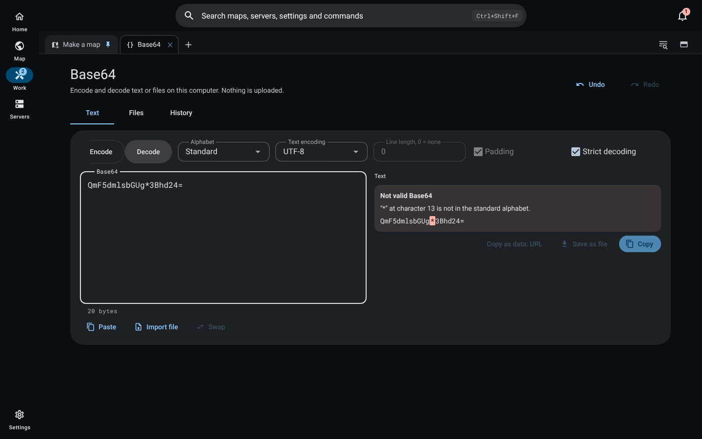
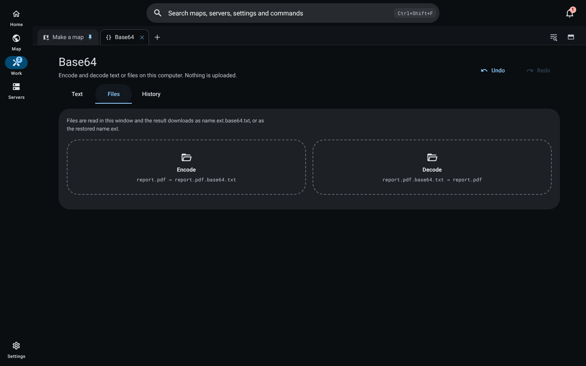
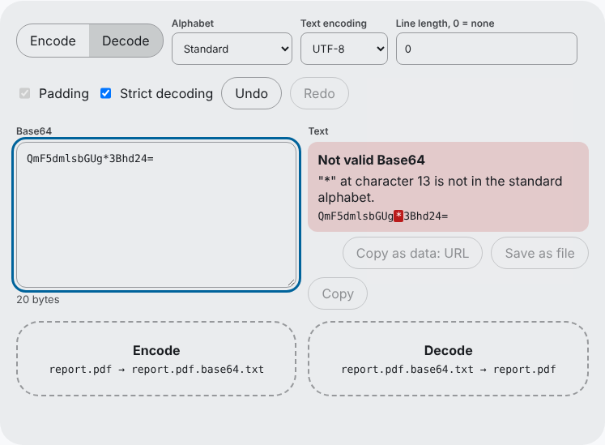

# Base64

The **Base64** job encodes and decodes text and files on this computer. Nothing is uploaded. Open it from the command palette (`Ctrl+Shift+F`, then type "Base64") or from the Work tabs.

## Text

- **Alphabets:** standard (RFC 4648 section 4), URL-safe (section 5) and MIME (76 characters per line with CRLF), plus any line length.
- **Padding** on or off when encoding. **Strict decoding** refuses anything outside the alphabet, spaces, line breaks outside MIME and wrong padding, and names the exact character and its position; lenient decoding ignores whitespace, accepts both alphabets and missing padding.
- **Text encodings:** UTF-8, UTF-16 LE, UTF-16 BE and Latin-1. Text that cannot be written in the chosen encoding is reported, never mangled. Byte counts show on both sides.
- **Import** from a file, the clipboard or a paste; a pasted `data:` URL is decoded straight away.
- **Export:** copy, copy as a `data:` URL, save as a file (never over an existing one), or a JSON record of the conversion.
- A failed decode never shows partial output.

## Files

Drop a file on **Encode** and Worldlens writes `name.ext.base64.txt` beside it. Drop that text file on **Decode** and it writes `name.ext` back beside it. The name comes from the `.base64.txt` or `.b64` pattern first, then a leading `data:` URL's type, then the decoded bytes' signature, and `.bin` last. Neither direction overwrites: a taken name gets a number before the extension, such as `report (1).pdf`.

Files of any size are streamed through one megabyte at a time into a hidden partial file. Encoded output is decoded again and its SHA-256 compared with the source; decoded output is read back and its SHA-256 compared with what was decoded. Only a match is renamed into place. Pause, resume and cancel work at any point, and a cancel or failure leaves nothing behind. Results show the SHA-256 and a **Show in folder** action; decoded results get a preview. Finished jobs export as a `.zip` of their JSON records and any result up to 256 KB.

Without the desktop app (a hosted workspace), files up to 256 MB are read in the window and the result downloads under the same names.

## Preview

The preview element is chosen from the bytes' signature, never a name or claimed type: images, audio and video play from a blob URL in plain media elements, text shows as text, and everything else, SVG and HTML included, is a hex dump. Nothing decoded is run, opened or framed.

## History and undo

Every copy, save and file conversion is a history entry with names, sizes and SHA-256, never the payload. Undo and redo are unlimited. They survive a restart only when **Keep inputs on this computer** is on, because by default nothing typed is written to disk. Clearing history needs the two-key confirmation.

## On the documentation site

The site's Base64 article (`#/docs/base64`) carries the same tool, built from the same shared code: every alphabet and option, exact error positions, history and undo. A web page cannot write beside a file, so files are read in the page (up to 256 MB) and the result downloads as `name.ext.base64.txt` or the restored `name.ext`.

## Verification

- `design/packages/shared/src/base64.test.ts`: round trips for every alphabet, padding option and length remainder against Node's encoder; RFC 4648 test vectors (removing padding from the encoder turns this red); strict offsets; every text encoding; `data:` URLs; naming order; preview kinds; hex dump; CRC-32 and a ZIP read back by Python's `zipfile`; streaming in odd chunk sizes.
- `design/packages/app/src/main/base64/files.test.ts`: the same-folder round trip with numbered names, `data:` and signature naming, refusal of non-Base64 text with nothing left behind, a 128 MB file streamed in bounded memory with the exact output length, pause and cancel, and exports that never overwrite.
- `design/packages/ui/src/components/base64/Base64Screen.test.ts`: conversion and truthful failures, 300-step undo surviving a restart only when inputs are kept, history without payloads, the exact bad-character mark, typing as one undo step, and a safe preview that never renders SVG markup.
- `design/packages/site/src/tools/base64Tool.test.ts`: the site tool encodes as you type, marks the exact bad character, steps back through undo and redo, never renders decoded markup and follows the language setting.
- Screenshots come from the built interface and the built site in headless Chrome, without the desktop bridge.
