# Current configuration gallery

Captured from the verified native desktop build at source `49d009b5ad685022abbb47dcff00b43305589ba8` on 22 October 2026. Each original PNG was inspected and promoted without cropping, recompression or pixel changes. Native navigation, search, group disclosure and settings controls produced these scenes. Scroll positioning selected useful controls without hiding content.

All scenes recorded zero console errors and zero page exceptions during observation. These are bounded visual and interaction observations, not proof of real-folder saving, populated history, deletion, installer behavior or a complete language/display matrix.

## Render-thread and priority controls

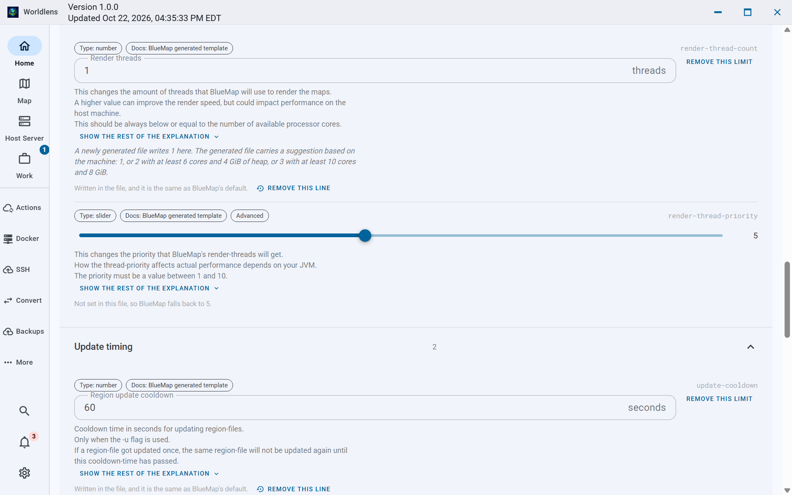

Captured 2026-10-22T20:44:54.246Z; source 49d009b5; 1280 by 800 logical viewport; 1920 by 1200 native pixels; en, light; application zoom 100%; actual display DPI 144.

Capture interval: `2026-10-22T20:44:51.428Z` to `2026-10-22T20:44:54.246Z`. SHA-256: `6823067107508531b17a7f1f885c6aa3a72d4c8fbc95160314ba50d10ac8d751`.

## Core form and recorded download choice

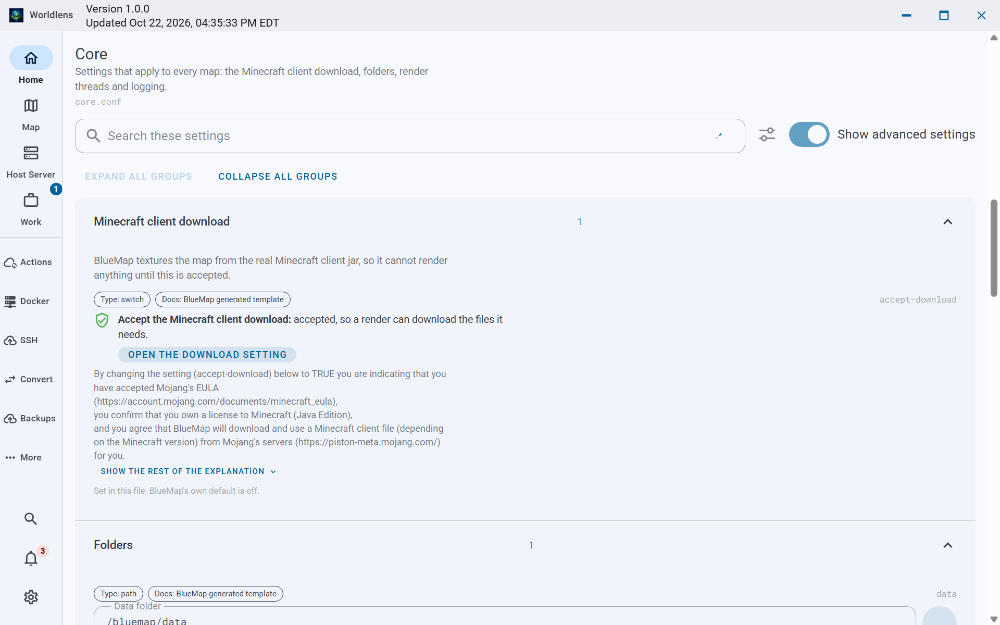

Captured 2026-10-22T20:39:51.498Z; source 49d009b5; 1280 by 800 logical viewport; 1920 by 1200 native pixels; en, light; application zoom 100%; actual display DPI 144.

Capture interval: `2026-10-22T20:39:48.117Z` to `2026-10-22T20:39:51.498Z`. SHA-256: `064dba462d9502daf135c6401d3e86d7756beaeb2f25e5716f2b1bf5b3a28d35`.

## Map selection and fields

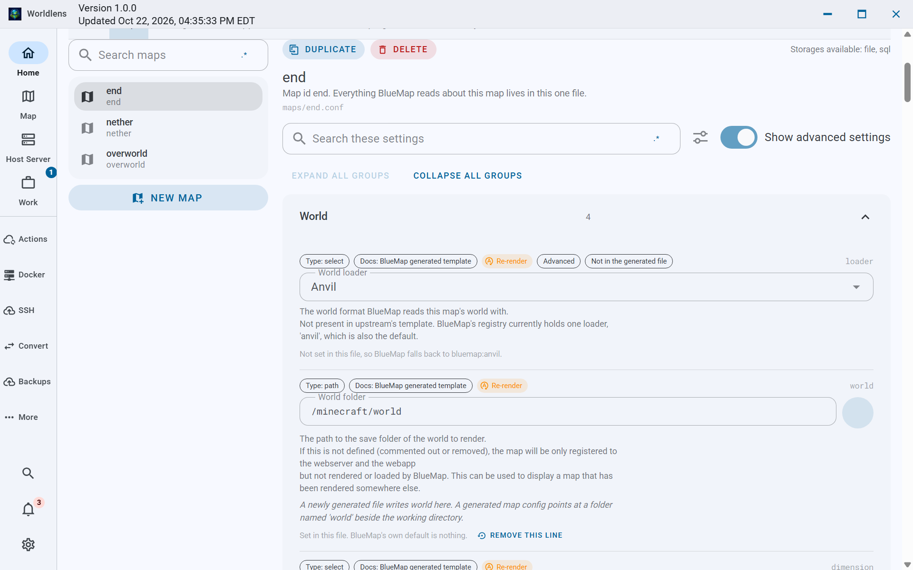

Captured 2026-10-22T20:40:02.077Z; source 49d009b5; 1280 by 800 logical viewport; 1920 by 1200 native pixels; en, light; application zoom 100%; actual display DPI 144.

Capture interval: `2026-10-22T20:39:59.03Z` to `2026-10-22T20:40:02.077Z`. SHA-256: `54ce2c7e3f0656474429c2e3ea2d590d83240d76bcebdec54c6776bb418e2808`.

## Storage selection and fields

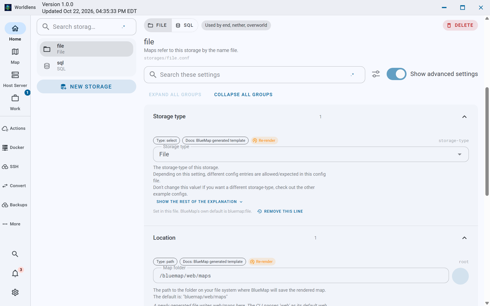

Captured 2026-10-22T20:40:12.676Z; source 49d009b5; 1280 by 800 logical viewport; 1920 by 1200 native pixels; en, light; application zoom 100%; actual display DPI 144.

Capture interval: `2026-10-22T20:40:10.043Z` to `2026-10-22T20:40:12.676Z`. SHA-256: `65cfe6953807f0f43fde1a160b7946d41aad8209b653c8c46a8e8a5a9cf691de`.

## Web app groups expanded

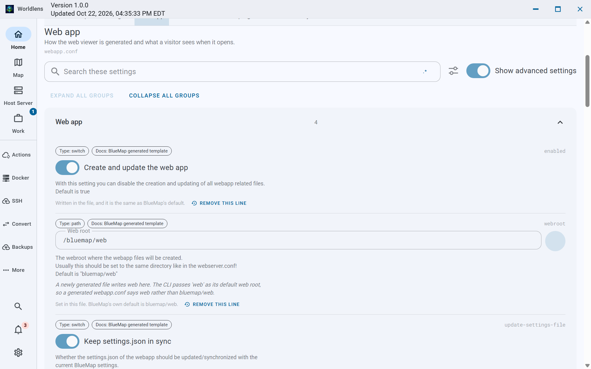

Captured 2026-10-22T20:40:26.009Z; source 49d009b5; 1280 by 800 logical viewport; 1920 by 1200 native pixels; en, light; application zoom 100%; actual display DPI 144.

Capture interval: `2026-10-22T20:40:22.788Z` to `2026-10-22T20:40:26.009Z`. SHA-256: `59142cbc905e9f041d65069055f6ae5b80cde455db05a0ecb3348703b7088e8c`.

## Built-in web server fields

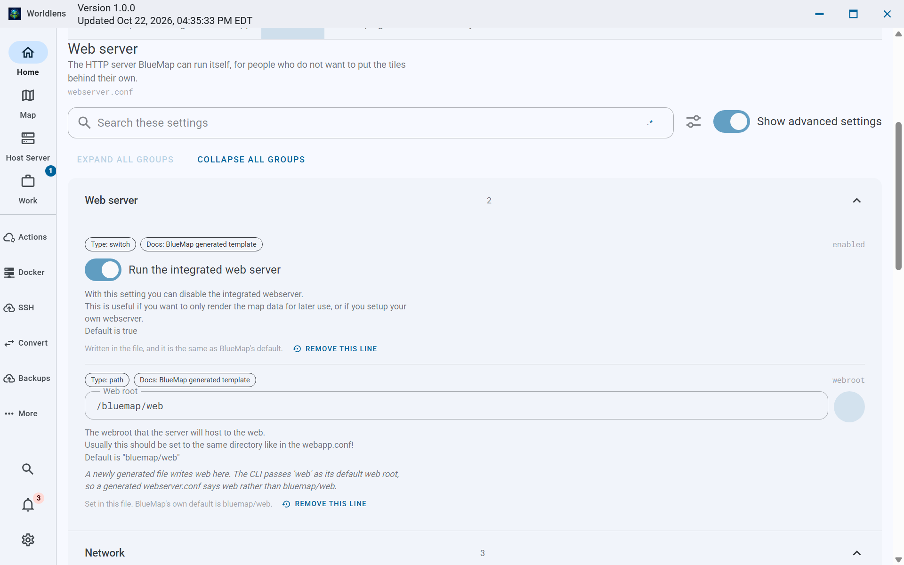

Captured 2026-10-22T20:40:51.907Z; source 49d009b5; 1280 by 800 logical viewport; 1920 by 1200 native pixels; en, light; application zoom 100%; actual display DPI 144.

Capture interval: `2026-10-22T20:40:48.482Z` to `2026-10-22T20:40:51.907Z`. SHA-256: `4139d4e897551a6f9771ebff3469e0753f70e92fc1ba30e7159d789b953f396c`.

## Server plugin fields

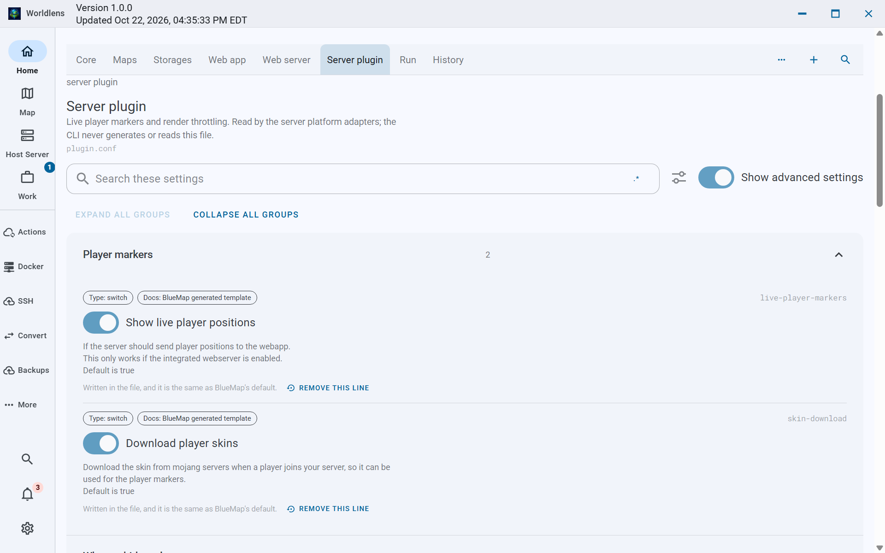

Captured 2026-10-22T20:41:02.942Z; source 49d009b5; 1280 by 800 logical viewport; 1920 by 1200 native pixels; en, light; application zoom 100%; actual display DPI 144.

Capture interval: `2026-10-22T20:41:00.091Z` to `2026-10-22T20:41:02.942Z`. SHA-256: `54f6db4ed04be107da88d5f77c27f59833a49d9c2a4f05c34f85fcfaf4868604`.

## Run flags

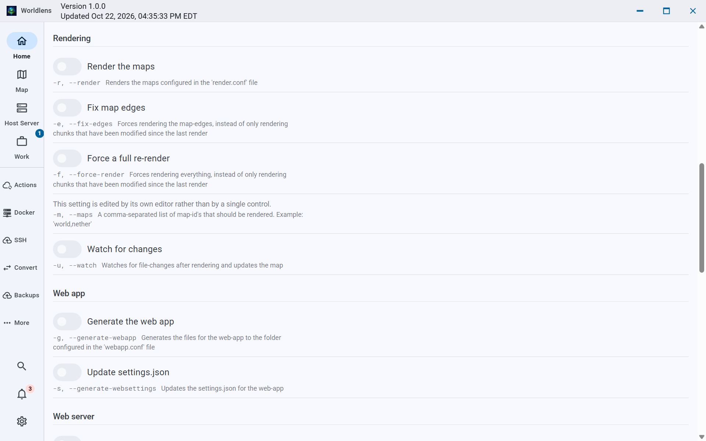

Captured 2026-10-22T20:41:13.751Z; source 49d009b5; 1280 by 800 logical viewport; 1920 by 1200 native pixels; en, light; application zoom 100%; actual display DPI 144.

Capture interval: `2026-10-22T20:41:10.79Z` to `2026-10-22T20:41:13.751Z`. SHA-256: `0b2f8ed980990671df165020dff581c3d36a6c78d8dd1ee071566abb11bd892f`.

## History before a folder is saved

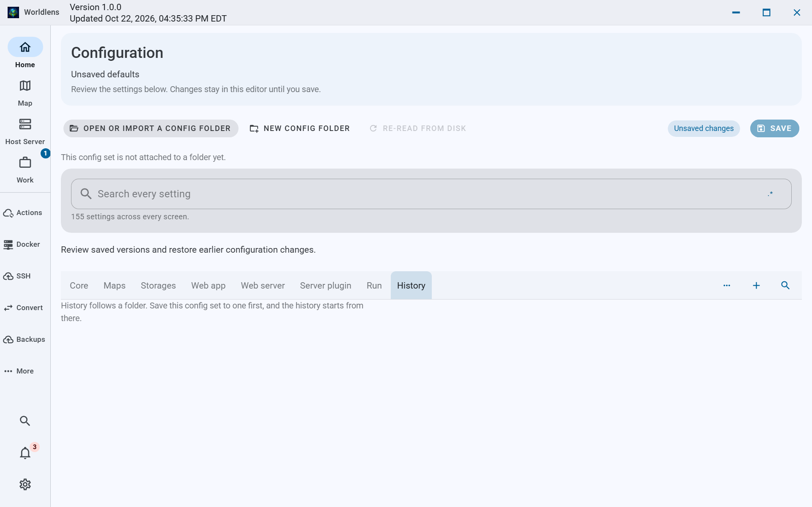

Captured 2026-10-22T20:41:23.892Z; source 49d009b5; 1280 by 800 logical viewport; 1920 by 1200 native pixels; en, light; application zoom 100%; actual display DPI 144.

Capture interval: `2026-10-22T20:41:21.116Z` to `2026-10-22T20:41:23.892Z`. SHA-256: `134bd92523e5cfd2a1625e0c3bd784761276bcf181862e84aeeb603ca483bcd4`.

## Web app groups collapsed

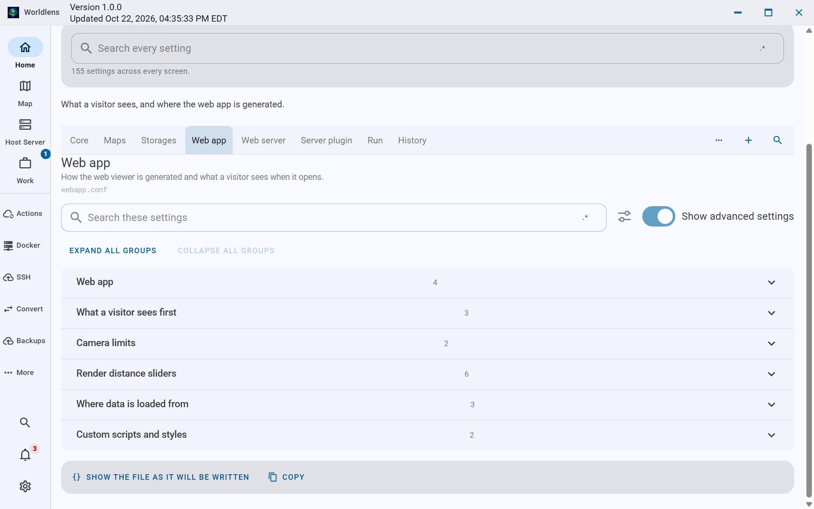

Captured 2026-10-22T20:40:37.104Z; source 49d009b5; 1280 by 800 logical viewport; 1920 by 1200 native pixels; en, light; application zoom 100%; actual display DPI 144.

Capture interval: `2026-10-22T20:40:34.284Z` to `2026-10-22T20:40:37.104Z`. SHA-256: `53846cfd5ec818a4a2057144501a6117dd4aa61846cb3b9cebb5ff62481e01dd`.

## Search across configuration screens

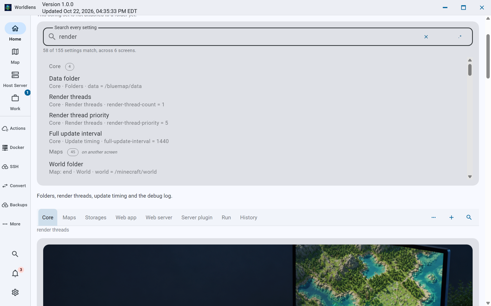

Captured 2026-10-22T20:48:16.348Z; source 49d009b5; 1280 by 800 logical viewport; 1920 by 1200 native pixels; en, light; application zoom 100%; actual display DPI 144.

Capture interval: `2026-10-22T20:48:13.006Z` to `2026-10-22T20:48:16.348Z`. SHA-256: `7d4f67751e3862ddaad9ccea16b72ca80976e7bbeb5b633e32c4c55debb043f2`.

## Anchored regex builder

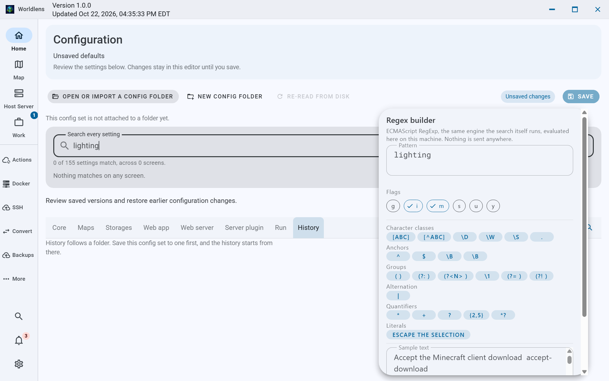

Captured 2026-10-22T20:41:50.798Z; source 49d009b5; 1280 by 800 logical viewport; 1920 by 1200 native pixels; en, light; application zoom 100%; actual display DPI 144.

Capture interval: `2026-10-22T20:41:47.969Z` to `2026-10-22T20:41:50.798Z`. SHA-256: `a8c26c9af5a404ed93e18c9f35b8899a3a17917d4a1ce679a359541d528fcee9`.

## Locked map deletion confirmation

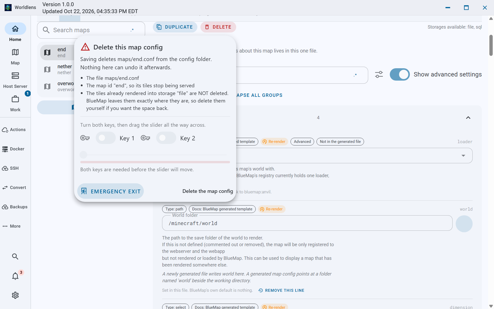

Captured 2026-10-22T20:44:39.968Z; source 49d009b5; 1280 by 800 logical viewport; 1920 by 1200 native pixels; en, light; application zoom 100%; actual display DPI 144.

Capture interval: `2026-10-22T20:44:35.972Z` to `2026-10-22T20:44:39.968Z`. SHA-256: `33e9fea2cc2a971aaa08950304c7a887ef1e3d50b15b5a95f26160c862fb4dc6`.

## Bilingual controls at minimum size

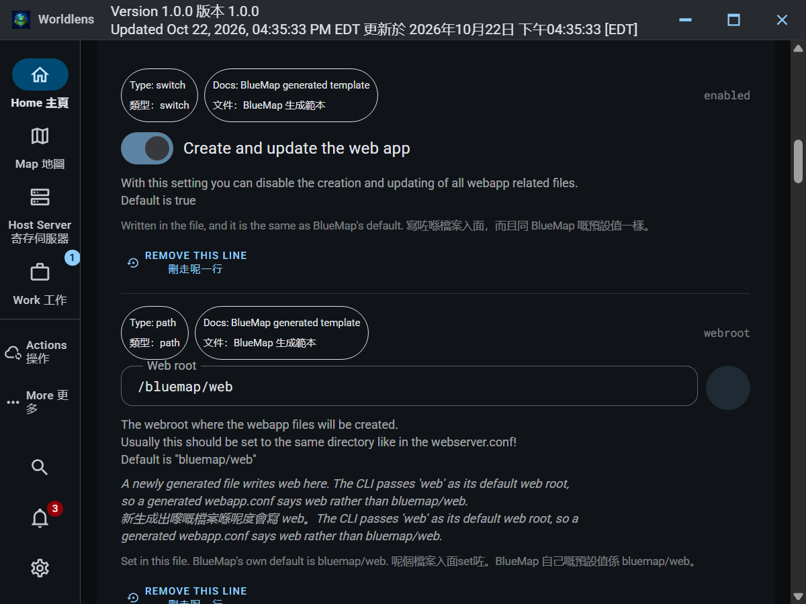

Captured 2026-10-22T20:50:11.044Z; source 49d009b5; 800 by 600 logical viewport; 1200 by 900 native pixels; bilingual, dark; application zoom 100%; actual display DPI 144.

Capture interval: `2026-10-22T20:50:07.313Z` to `2026-10-22T20:50:11.044Z`. SHA-256: `732686bd549fa52d9494cfd1fe675230b0b94cc965a93e76b779d135efd3bdbf`.

## Search with no matches

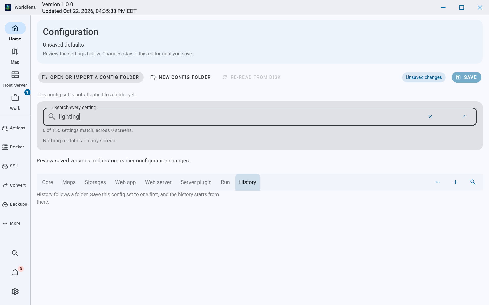

Captured 2026-10-22T20:41:40.173Z; source 49d009b5; 1280 by 800 logical viewport; 1920 by 1200 native pixels; en, light; application zoom 100%; actual display DPI 144.

Capture interval: `2026-10-22T20:41:37.36Z` to `2026-10-22T20:41:40.173Z`. SHA-256: `7cc9b4e7d8cdc1024190f89be62a6b76eb4c01941e60dd3e24c4474d932c293a`.

## Scope and preservation

The first search example intentionally has no matches; the separate result-bearing search contains 58 matches across six screens. The map deletion confirmation stayed locked and was canceled. Generated default paths are examples, not user folders. History remains unavailable until a folder is saved. The large illustration belongs to the separate speed card; field-focused scenes scroll past it without modifying the rendered content.

[Earlier configuration images](../screenshots/archive/config-editor-before-20261022.md) retain their original bytes and available provenance. [Previous catalogue descriptions](../screenshots/archive/config-catalogue-before-49d009b5.md) are preserved separately.

## 廣東話

呢十五張圖喺 2026 年 10 月 22 日，從來源版本 `49d009b5` 嘅真實桌面程式擷取，保留原始像素，冇裁剪或者改圖。畫面包括全部八個設定分頁、展開同收起群組、跨頁搜尋、正規表達式建構器、鎖定嘅刪除確認，同最細視窗嘅雙語深色設定。搜尋結果有 58 項，來自六個畫面；另外保留零結果嘅例子。

全程用產生嘅預設設定，冇儲存或修改使用者檔案。歷史畫面如實顯示要先儲存到資料夾；刪除確認維持鎖定，之後取消。每張圖列明實際 UTC 時間、來源版本同雜湊。呢啲證據唔等於完整安裝、全部語言／顯示比例或者真實檔案儲存驗收。舊圖同原有出處另行保留。
