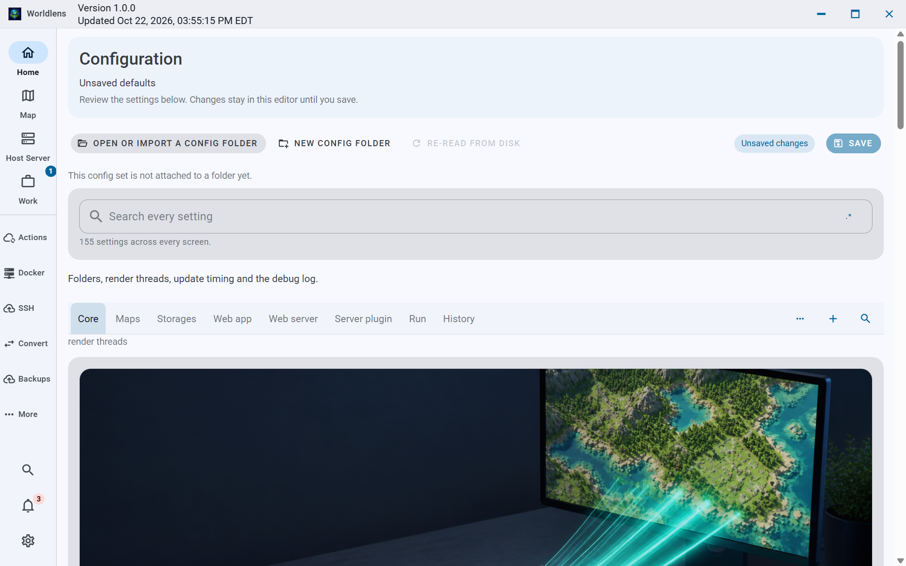

# Configuration workspace

The header identifies the open folder, browser preview or unsaved defaults. Save-disabled explanations remain visible. Guidance follows the active tab. All eight tabs, advanced controls, independent search builders, raw-file recovery and serialization remain available. Expand and collapse controls change group navigation without removing fields.

The raw native image is bound to source ae1df096 and its verified root build. English light theme, 1280 by 800 logical viewport, application zoom 100%, actual display DPI 144. Seventeen layout tuples and bounded native group/keyboard interactions passed; the remaining language tuples are still being checked. This picture does not prove a real-folder save or complete accessibility acceptance.

## Current control and workflow images

The [current gallery](current-gallery.md) contains fifteen source-bound native images of all eight tabs, group expansion and collapse, grouped search results, the regex builder, locked deletion review and bilingual minimum-size controls. It preserves generated-default and no-folder limitations explicitly. Earlier images and timestamps remain in the linked archive.

## 廣東話

[最新畫面集](current-gallery.md) 有十五張綁定來源版本嘅真實畫面，包含全部八個分頁、群組展開／收起、搜尋、正規表達式建構器、鎖定刪除確認同最細視窗雙語控制。使用產生嘅預設設定，冇儲存使用者檔案；歷史畫面嘅未附資料夾狀態亦如實保留。
