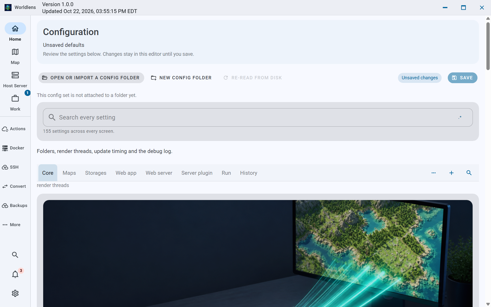

# Configuration workspace

The header identifies the open folder, browser preview or unsaved defaults. Save-disabled explanations remain visible. Guidance follows the active tab. All eight tabs, advanced controls, independent search builders, raw-file recovery and serialization remain available. Expand and collapse controls change group navigation without removing fields.

The raw native image is bound to source ae1df096 and its verified root build. English light theme, 1280 by 800 logical viewport, application zoom 100%, actual display DPI 144. Seventeen layout tuples and bounded native group/keyboard interactions passed; the remaining language tuples are still being checked. This picture does not prove a real-folder save or complete accessibility acceptance.
