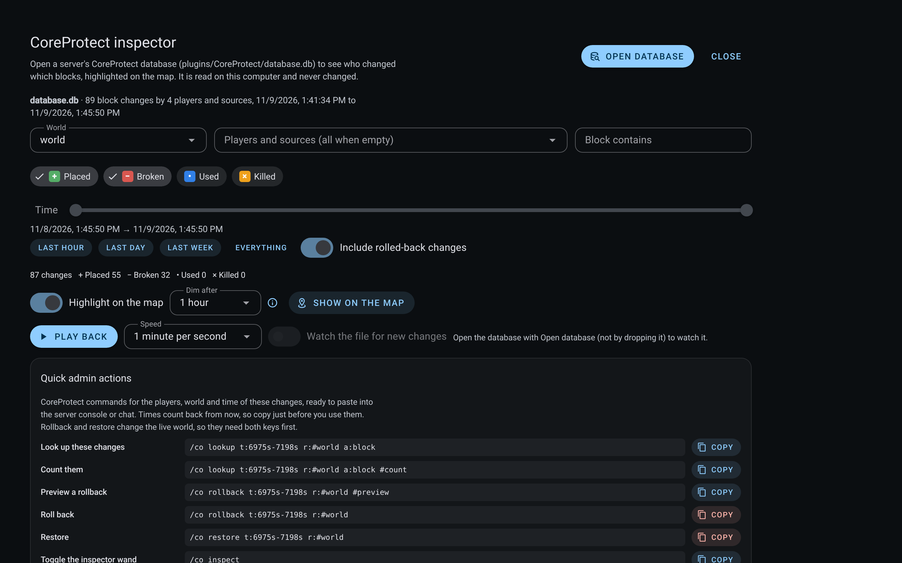
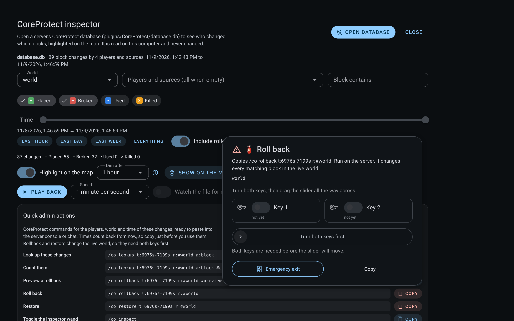

# CoreProtect inspector

The **CoreProtect inspector** opens a server's CoreProtect database and shows who changed which blocks, highlighted on the live map. Open it from the Work tabs (the **+** menu, then **CoreProtect inspector**). It works the same in the desktop app and in a hosted map served to a browser: the database is read inside the page, on the computer looking at it, and is never uploaded or changed.

## Opening a database

CoreProtect's default store is SQLite, at `plugins/CoreProtect/database.db` on the server. Copy that file to this computer, or open it from a shared folder, then choose **Open database** or drop it on the inspector. Files up to 1 GB are read.

The inspector checks the file is SQLite and has CoreProtect's tables before showing anything. It finds the table prefix itself (`co_` by default, or whatever `table-prefix` is set to), and refuses a file that is not a CoreProtect database instead of showing an empty result.

What it reads, from CoreProtect's own schema:

| Table | Columns used |
| --- | --- |
| `block` | `time` (Unix seconds), `user`, `wid`, `x`, `y`, `z`, `type`, `action`, `rolled_back` |
| `user` | `id`, `user` (names starting with `#` are sources such as `#creeper` or `#tnt`) |
| `world` | `id`, `world` |
| `material_map` | `id`, `material` (an unmapped id shows as `#<id>`) |

`action` is 0 for a block broken, 1 for a block placed, 2 for an interaction and 3 for an entity killed.

## Filtering

- **World**, with every world in the database to choose from.
- **Players and sources**, picked from the names in the database; empty means everyone.
- **Block contains**, a case-insensitive part of the material name. `%` and `_` are matched literally.
- **Action** chips: placed, broken, used, killed. Each has its own colour, glyph and word, so colour is never the only signal.
- **Time**, a range slider across the whole database, with Last hour, Last day, Last week and Everything presets.
- **Include rolled-back changes**.

On opening, the filter starts on the overworld (or the first world) over the last day of activity. At most 200,000 matching changes are read at once; when there are more, the inspector says so and asks for a narrower filter.

## On the map

With **Highlight on the map** on, every changed block is drawn on the running map as a coloured square just above the block, drawn through terrain so it is never hidden. Only the last change at each block is drawn, so a block placed and then broken shows as broken. The newest changes are brightest and fade over the **Dim after** period (10 minutes, an hour, a day, or never). At most 4,000 squares are drawn, newest first, and the count is shown. Each square names the action, the block and who did it, and its popup adds the coordinates. **Show on the map** moves the camera to the middle of the filtered changes and switches to the map.

The layer is a normal marker set, so it can be hidden from the map's marker list. It stays on the map while the inspector tab is closed.

## Real time: replay and watching

- **Play back** replays the filtered changes in time order at 1 second to 1 hour of server time per second. While it plays, the map shows only the changes that had happened by then, and a small bar over the map has play, pause, stop and the current time.
- **Watch the file for new changes** reads the database again every 5 seconds and redraws when the file has changed, so a database a running server is writing shows new changes as they land. While watching, the time window grows to include new changes. Watching needs a file opened through **Open database** in a browser that can keep a file open to read it again (Chromium, including the desktop app). A dropped file cannot be read again, and the inspector says so next to the switch.

## Quick admin actions

The inspector builds CoreProtect commands for the players, world and time of the filtered changes, ready to paste into the server console or chat:

| Action | Command |
| --- | --- |
| Look up these changes | `/co lookup u:<players> t:<newest>-<oldest> r:#<world> a:block` |
| Count them | the same with `#count` |
| Preview a rollback | `/co rollback ... #preview` |
| Roll back | `/co rollback ...` |
| Restore | `/co restore ...` |
| Toggle the inspector wand | `/co inspect` |
| Teleport to a change | `/tp @s x y z`, after choosing a change in the table |

CoreProtect's times count back from now, so the range is worked out when the command is copied and widened by a second at each end; copy just before using it. Only names and world names that cannot break out of an argument are written into a command. **Roll back** and **Restore** change the live world, so both need the two keys and the slider before the command is copied.

## Export

The filtered changes export as CSV (cells that start like a formula are neutralised for spreadsheets) or as JSON with the schema `worldlens.coreprotect.changes/1`. The table lists the newest 500, each with a button that shows it on the map.

## Security

The database is opened read-only, in memory, on this computer; nothing is sent anywhere. The SQLite engine is WebAssembly bundled with the app, which is why the content security policy allows `'wasm-unsafe-eval'` (WebAssembly compilation only; `'unsafe-eval'` stays off). The hosted server serves `.wasm` as `application/wasm`. Names inside the database are someone else's text: they are stripped of markup in labels and escaped in popups. Queries use bound parameters, and the detected table prefix must be letters, digits and underscores.

## Not yet

- Sending a command to the server over RCON from the inspector. The commands are copied, not run.
- Databases on MySQL. Export the tables to SQLite first.
- Containers, item transactions, chat and sign tables. Only block changes are read.

## Verification

- `design/packages/ui/src/components/coreprotect/coreprotect.test.ts` (10 tests) builds a database with CoreProtect's layout and checks: reading the worlds, players and range; a custom table prefix; refusing a file that is not CoreProtect; every filter, including literal `%` and `_`; the over-limit notice; the highlight layer drawing only the latest change per block, newest first, with escaped markup; replay; the summary; command arguments, refused unsafe names and the teleport command; and CSV.
- Screenshots come from the built interface in headless Chrome on Linux (9 November 2026), with the test database opened through the real loading path. The map highlight itself was not captured, because the map viewer bundle is not built in that environment.

## 廣東話

**CoreProtect 檢查器** 打開伺服器嘅 CoreProtect 資料庫,睇邊個郁過邊啲方塊,喺即時地圖上面標出嚟。喺「工作」分頁(**+** 選單,再揀 **CoreProtect 檢查器**)開。桌面程式同網上寄存嘅地圖都一樣用得:資料庫喺睇緊嗰部電腦嘅頁面入面讀,唔會上載,亦唔會改。

- **打開資料庫:** CoreProtect 預設用 SQLite,喺伺服器嘅 `plugins/CoreProtect/database.db`。複製去呢部電腦或者喺共用資料夾開,撳 **開資料庫** 或者拖入去。最大讀 1 GB。佢會先檢查係咪 SQLite 同有冇 CoreProtect 啲表,自己搵表前綴(預設 `co_`),唔係 CoreProtect 嘅檔案會直接拒絕,唔會扮冇資料。讀 `block`、`user`、`world` 同 `material_map` 四個表;`action` 0 係拆、1 係放、2 係用、3 係殺;`#` 開頭嘅名係 `#creeper`、`#tnt` 呢類來源。
- **篩選:** 世界、玩家同來源(空白即係全部)、方塊名包含(`%` 同 `_` 照字面計)、動作晶片(放、拆、用、殺,每個有自己顏色、符號同字,唔會淨靠顏色)、時間範圍滑桿同「最近一個鐘、一日、一個禮拜、全部」、包唔包已還原嘅改動。一開就揀主世界最近一日。一次最多讀 200,000 個改動,再多會叫你收窄。
- **地圖上面:** 開咗 **喺地圖上標示**,每個郁過嘅方塊上面會畫一格顏色方格,穿過地形都見到。每格只畫最後一次改動,最新嘅最光,按 **幾耐之後變暗** 慢慢淡。最多畫 4,000 格,新嘅先。**喺地圖上睇** 會將鏡頭移去改動中間。熄咗檢查器分頁,圖層照樣留喺地圖。
- **即時:** **重播** 按時間次序播返,每秒 1 秒到 1 個鐘伺服器時間,地圖上面有細細條控制列。**監察檔案** 每 5 秒讀多次,檔案變咗就重畫,伺服器一邊寫你一邊見到;要用 **開資料庫** 開(Chromium 同桌面程式),拖入嚟嘅檔案讀唔返第二次,旁邊會講明。
- **快捷管理指令:** 按篩選出嚟嘅玩家、世界同時間砌好 CoreProtect 指令俾你貼去伺服器:查詢、計數、預覽還原、還原、恢復、開關檢查棒、傳送去某個改動。CoreProtect 嘅時間係由而家計返轉頭,所以複製嗰陣先計,兩邊各加一秒;用之前先複製。危險字元嘅名唔會寫入指令。**還原** 同 **恢復** 會改真世界,要過兩條鎖匙同滑桿先複製到。
- **匯出:** CSV(似公式嘅格會中和)或者 JSON(`worldlens.coreprotect.changes/1`)。表格列最新 500 個。
- **安全:** 唯讀、喺記憶體、喺呢部電腦,乜都唔送出去。SQLite 引擎係隨程式附帶嘅 WebAssembly,所以內容安全政策開咗 `'wasm-unsafe-eval'`(淨係准編譯 WebAssembly,`'unsafe-eval'` 照關)。寄存伺服器用 `application/wasm` 送 `.wasm`。資料庫入面啲名係人哋寫嘅字,標籤會刪走標記,彈出視窗會轉義。查詢用綁定參數。
- **未做:** 經 RCON 直接喺檢查器送指令(而家只係複製);MySQL 資料庫(請先匯出做 SQLite);箱、物品交易、聊天同告示牌表(而家只讀方塊改動)。
- **驗證:** `coreprotect.test.ts` 10 個測試;截圖係 2026 年 11 月 9 日用建好嘅介面喺無頭 Chrome 用真嘅載入流程開測試資料庫影嘅。地圖標示本身未影到,因為嗰個環境冇建地圖檢視器。
