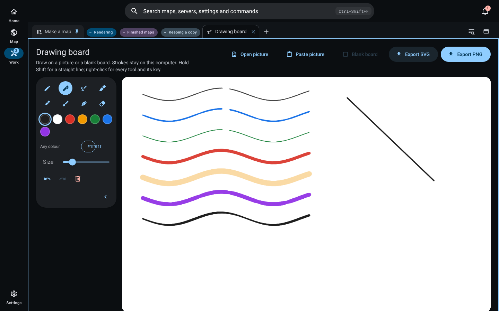
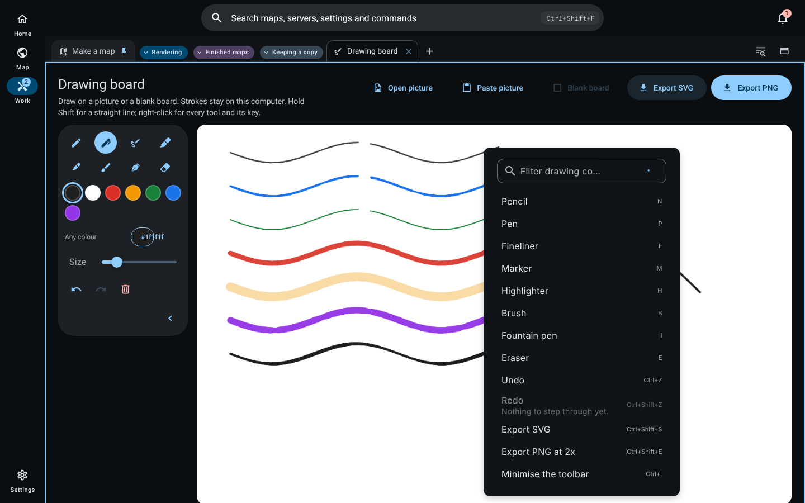

# Drawing board

The **Drawing board** job is for drawing on a picture or a blank board: marking up a screenshot of a map, sketching a build, or circling the chunk that rendered wrong. Open it from the Work tabs (the **+** menu, then **Drawing board**). Strokes stay on this computer.

## Pens and the eraser

| Tool | Key | Width |
| --- | --- | --- |
| Pencil | N | Thins as the stroke speeds up |
| Pen | P | Thins as the stroke speeds up |
| Fineliner | F | Constant |
| Marker | M | Constant |
| Highlighter | H | Constant, see-through |
| Brush | B | Thins strongly as the stroke speeds up |
| Fountain pen | I | Follows direction, like a nib held at 45 degrees |
| Eraser | E | Removes only what it touches, so erasing the middle of a line leaves two lines |

Hold **Shift** while drawing for a straight line locked to the nearest of eight directions. Colour comes from seven swatches or the full colour picker (any colour, with every colour format); the size slider scales the pen from half to three times its width. Pen, mouse and touch all draw.

## Keys and the right-click menu

Every tool and action has a key, shown in its tooltip and in the board's right-click menu, which comes from the same table the key handler reads, so a key shown is a key that works. The menu has its own search field.

| Action | Key |
| --- | --- |
| Undo | Ctrl+Z |
| Redo | Ctrl+Shift+Z (Ctrl+Y also works) |
| Export SVG | Ctrl+Shift+S |
| Export PNG at 2x | Ctrl+Shift+E |
| Minimise or show the toolbar | Ctrl+. |

## Pictures, saving and export

- **Open picture** reads a PNG, JPEG, WebP or GIF; **Paste picture** (or Ctrl+V on the board) takes one from the clipboard; **Blank board** goes back to white. Pictures are fitted within 2,400 pixels on the long side.
- The board, its undo and redo history (the last 100 steps) and the picture are saved in this window's storage and come back after a restart. A picture too large to keep is said so plainly; the strokes are still kept.
- **Clear** removes every stroke behind the two-key confirmation. It is available once there is a stroke, and undo brings the strokes back.
- **Export SVG** writes exactly what is on screen: the same segments the canvas draws, erasing included, with the picture embedded. **Export PNG** writes 1x, 2x or 3x. See-through pens are composited once per stroke on screen and in both exports, so overlapping parts of one highlighter stroke never darken.
- The toolbar minimises to a disc that still shows the active tool; its state, the tool, colour and size are remembered. Reduced motion turns off the toolbar's shape animation.

## Security

Nothing is uploaded. A colour that is not a plain colour value never reaches the SVG, and only an image `data:` URL is embedded, so an exported file cannot carry script.

## Not yet

Drawing directly on a live screenshot of the window and joining the app's local version history are not built.

## Verification

- `design/packages/ui/src/components/drawing/drawingModel.test.ts`: the seven pens and their keys, speed thinning for pencil, pen and brush, constant fineliner, marker and highlighter, direction for the fountain pen, gap filling, Shift lock to eight directions, partial erase that splits a stroke, SVG with exactly the canvas's segments, colours and backgrounds that cannot carry markup, undo and redo, and reading back a saved board.
- `design/packages/ui/src/components/drawing/DrawingBoard.test.ts`: every key picks its tool and matches its tooltip, draw, partial erase, undo and redo by key, strokes and undo surviving a restart, the right-click menu with every shortcut announced through `aria-keyshortcuts`, and Clear's stated condition.
- Screenshots come from the built interface in headless Chrome on Linux (8 November 2026), drawn with the mouse through each pen.

## 廣東話

**畫板** 工作俾你喺圖片或者白板上面畫:喺地圖截圖度圈重點、畫個建築草圖、或者圈出渲染錯咗嗰格。喺「工作」分頁(**+** 選單,再揀 **畫板**)開。筆劃留喺呢部電腦。

- **筆同擦膠:** 鉛筆(N)、原子筆(P)同毛筆(B)畫得快會變幼;針筆(F)、箱頭筆(M)同螢光筆(H)粗幼不變,螢光筆係半透明;墨水筆(I)跟方向變,好似 45 度拎住筆咀。擦膠(E)只會擦走掂到嘅部分,擦中間就會變兩條線。㩒住 **Shift** 畫,會鎖做八個方向入面最近嗰條直線。顏色有七個色板,亦可以用完整嘅顏色揀選器揀任何顏色;粗幼滑桿可以由一半調到三倍。筆、滑鼠同觸控都畫得。
- **快捷鍵同右鍵選單:** 每件工具同每個動作都有快捷鍵,喺提示同右鍵選單都見到;選單同按鍵處理用同一張表,所以見到嘅鍵一定用得。復原 Ctrl+Z、重做 Ctrl+Shift+Z(Ctrl+Y 都得)、匯出 SVG Ctrl+Shift+S、匯出 2 倍 PNG Ctrl+Shift+E、收埋或者打開工具列 Ctrl+.。選單有自己嘅搜尋欄。
- **圖片、儲存同匯出:** 「開圖片」讀 PNG、JPEG、WebP 或 GIF;「貼上圖片」(或者喺畫板撳 Ctrl+V)由剪貼簿攞;「白板」返去白色。畫板、最近 100 步嘅復原記錄同圖片都會儲喺呢個視窗,重開之後仲喺度;圖片太大儲唔落就會直講,筆劃照樣保留。「清除」要過兩條鎖匙,有筆劃先用得,撳復原可以攞返。匯出 SVG 同畫面一模一樣,包括擦過嘅位;PNG 可以揀 1、2、3 倍。半透明筆每一筆只疊一次,同一筆重疊嘅位唔會變深。
- **安全:** 乜都唔會上載。唔係普通顏色值嘅顏色唔會寫入 SVG,亦只會嵌入圖片 `data:` 網址,所以匯出嘅檔案唔會夾帶程式碼。
- **未做:** 直接喺視窗即時截圖上面畫、加入程式嘅本機版本記錄,未做。
- **驗證:** 上面列出嘅兩個測試檔;截圖係 2026 年 11 月 8 日用建好嘅介面喺無頭 Chrome 逐支筆用滑鼠畫出嚟。
