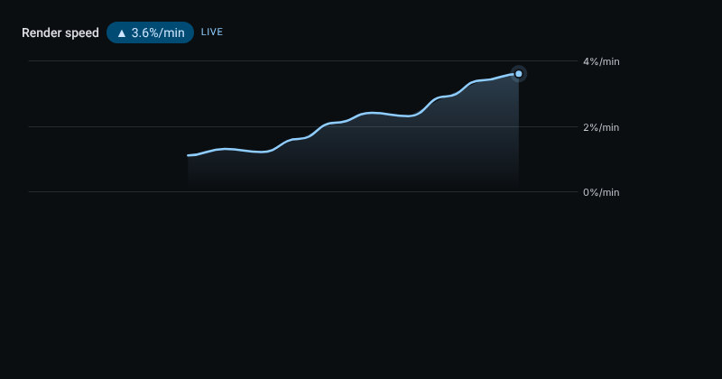
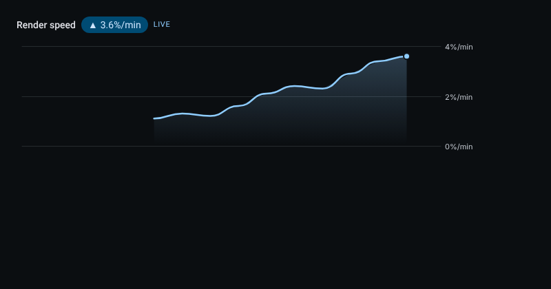

# Live charts

A chart whose data changes while it is on screen is drawn in one style everywhere. The first one is **Render speed**, under the speed control of a running render: every percent-per-minute reading the render reports joins the chart.

## What it does

- **Line and motion.** One smooth line through the real readings. The range, the newest point and the value badge ease about eight percent of the remaining distance per frame, so nothing jumps. A dot leads the line and pulses while the source is live.
- **Momentum.** The badge shows the latest value with an arrow (up, down or steady) and the trend in words for screen readers. A change under two percent of the level counts as steady. Colour is never the only signal.
- **Surface.** A soft gradient below the line from the theme's primary colour, a quiet grid with three labelled values, and the time in the person's language.
- **Scrubbing.** Move the pointer over the chart, or focus it and use the arrow keys, Home and End, to read the time and value of any reading. Escape clears it. Scrubbing only ever lands on a reading the source sent.
- **Screen readers.** The chart's name is a summary of the latest value and trend, and a polite live region repeats it as readings arrive.

## Honest states

| State | When | What it says |
| --- | --- | --- |
| Loading | The source has started and nothing has arrived | Waiting for the first readings |
| Live | Readings are arriving | The value, trend and a pulsing dot |
| Stale | No reading for 45 seconds while the source still runs | No new reading since the last time, the source has gone quiet |
| Paused | The source stopped | The last readings stay; new ones catch up when it resumes |
| Empty | Nothing has started | Nothing to show yet |

A chart never invents a point to look alive: easing moves only what is drawn between two real readings.

## Reduced motion

With reduced motion (the system setting or Low stimulation) the line, badge and range snap to each reading and the dot does not pulse. Every value, trend and state stays readable.

## Not yet

Time-window buttons, a reference line, several series with toggle chips and candlesticks are not built; Render speed has one series and none of those apply to it yet.

## Verification

- `design/packages/ui/src/components/charts/liveChartModel.test.ts`: easing and snapping, the visible window, a range that starts at zero and is never flat, grid steps, trend, scrubbing to the nearest reading, every honest state, and a bounded history that refuses out-of-order readings.
- `design/packages/ui/src/components/charts/LiveChart.test.ts`: the screen-reader summary and badge, keyboard scrubbing that stops at the first and last real reading, and the loading, paused and stale wording.
- Screenshots (8 November 2026) come from the chart mounted on its own in headless Chrome and fed ten readings one second apart, once with normal motion and once with reduced motion. The chart under a real render is the same component.

## 廣東話

畫面上數據會變嘅圖表,全部用同一個樣式。第一個係 **渲染速度**,喺渲染進行中嘅速度控制下面:渲染每報一次「每分鐘完成幾多 %」,就加一粒數入圖表。

- **線同動態:** 一條順滑嘅線穿過真實數據。範圍、最新嗰點同數值標籤每一格追返剩低距離大約 8%,唔會跳。最前面有粒圓點,來源仲喺度送數就會跳動。
- **走勢:** 標籤顯示最新數值,加一個箭咀(上、落或者平穩),螢幕閱讀器會讀出走勢。變動少過 2% 當平穩。唔會淨係靠顏色。
- **外觀:** 線下面有由主題主色漸變嘅填色,三條安靜嘅格線,時間用你嘅語言顯示。
- **拖動查看:** 將滑鼠移過圖表,或者用方向鍵、Home 同 End,可以睇任何一粒數嘅時間同數值;Escape 清除。只會停喺來源真正送過嚟嘅數。
- **老實嘅狀態:** 載入中(開始咗但未有數)、直播中、過時(來源仲行緊但 45 秒冇新數)、暫停(來源停咗,最後啲數留低,繼續嘅時候追返)、空白(未開始)。圖表永遠唔會自己作數扮生猛。
- **減少動態:** 開咗減少動態(系統設定或者低刺激模式),線、標籤同範圍會直接跳去新數,圓點唔會跳,所有數值同狀態照樣睇得清。
- **未做:** 時間範圍掣、參考線、多條數列同陰陽燭圖未做;渲染速度得一條數列,暫時用唔著。
- **驗證:** 上面列出嘅兩個測試檔;截圖係 2026 年 11 月 8 日將圖表單獨放喺無頭 Chrome,每秒餵一粒數,共十粒,正常動態同減少動態各影一次。
