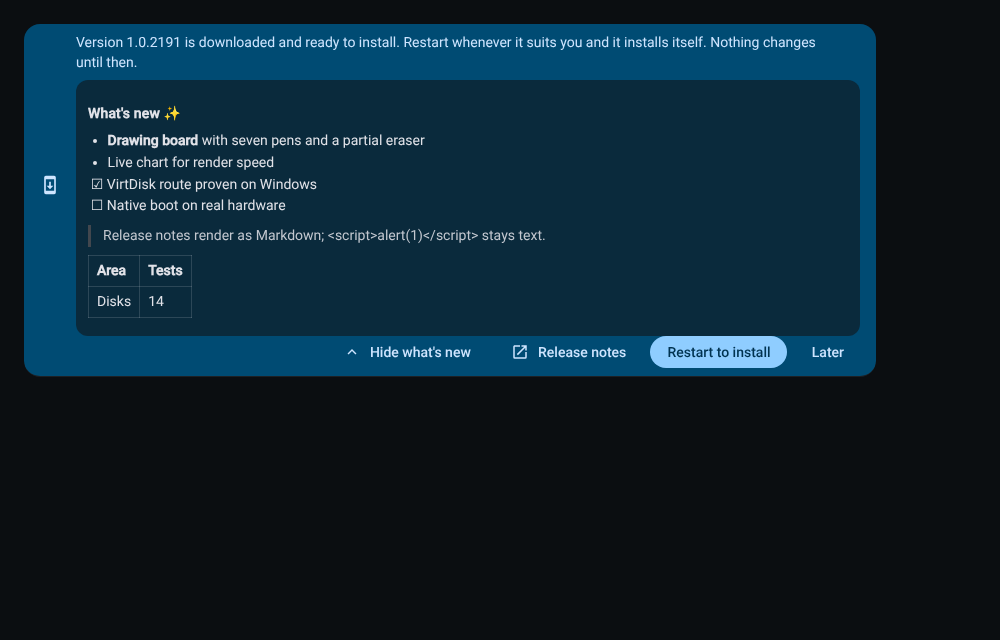

# Release notes and other provider text

Release notes, issue and pull-request bodies, commit messages and README previews are written by someone else in Markdown. Worldlens shows them as the formatted text they are, through one shared renderer.

## What it renders

Headings, paragraphs, bold, italic, strikethrough, inline code and fenced code blocks, bulleted and numbered lists with task boxes, quotes, tables, rules, links, bare web addresses, and GitHub emoji shortcodes such as `:tada:` and `:bug:`.

## Where

- The update banner's **What's new** button shows the update's own notes in place, so reading them needs no browser. Opening them does not read them aloud: they sit outside the banner's live announcement.

The screenshot (8 November 2026) shows the banner mounted on its own in headless Chrome with sample notes; the toggle was opened by a script click.

## Safety

The renderer parses the Markdown into a tree and builds the page from that tree. It never produces HTML, so nothing in the text can become markup, a script, a style or an event handler; raw HTML in the source is shown as text. Links are kept only for `http`, `https` and `mailto` addresses, or relative paths resolved against a base the surface names, and they open outside the app. Images are never fetched: each becomes a link that names the image. An empty source says "No notes were provided." rather than leaving an empty box.

## Verification

- `design/packages/ui/src/components/providerText/providerMarkdown.test.ts`: every block shape release notes use, raw HTML kept as text, unsafe links dropped and relative links resolved, images never fetched, and emphasis that does not eat `snake_case` words.
- `design/packages/ui/src/components/providerText/ProviderText.test.ts`: elements in a labelled region, links that open outside the app, no markup or script from provider text, the empty state, and named images.
- `design/packages/ui/src/components/update/UpdateBanner.test.ts`: the notes toggle, rendered Markdown, a script tag shown as text, and no toggle when there are no notes.

## 廣東話

更新說明、issue 同 pull request 內容、commit 訊息同 README 預覽,都係人哋用 Markdown 寫嘅。Worldlens 用同一個共用嘅顯示器,照返原本嘅格式顯示。

- **顯示乜:** 標題、段落、粗體、斜體、刪除線、行內程式碼同程式碼區塊、有剔格嘅項目同編號清單、引用、表格、分隔線、連結、網址,同埋 GitHub 嘅 emoji 代碼,例如 `:tada:` 同 `:bug:`。
- **喺邊度:** 更新橫額嘅「有乜新嘢」掣,會就地顯示今次更新自己嘅說明,唔使開瀏覽器;打開嗰陣唔會自動讀出嚟。
- **安全:** 先將 Markdown 拆成樹,再由棵樹砌畫面,永遠唔會產生 HTML,所以內文變唔到標記、程式、樣式或者事件;原始 HTML 只會當字顯示。連結只保留 `http`、`https` 同 `mailto`,或者按指定基準解析嘅相對路徑,會喺程式外面開。圖片永遠唔會下載,會變成講明係乜圖嘅連結。冇內容就會寫「冇提供說明。」,唔會留個空格扮壞咗。
- **驗證:** 上面列出嘅三個測試檔。
