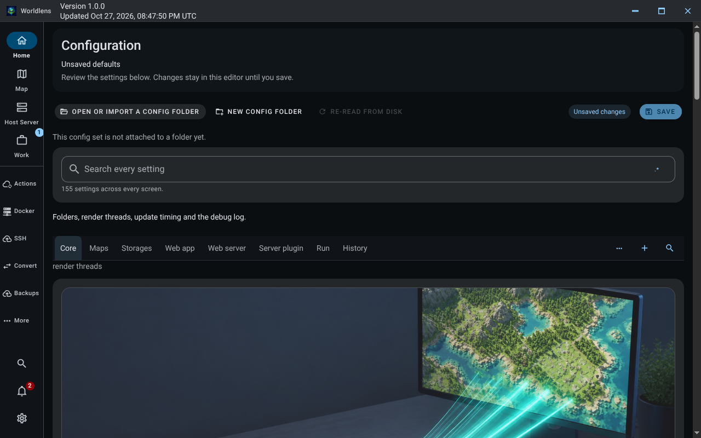
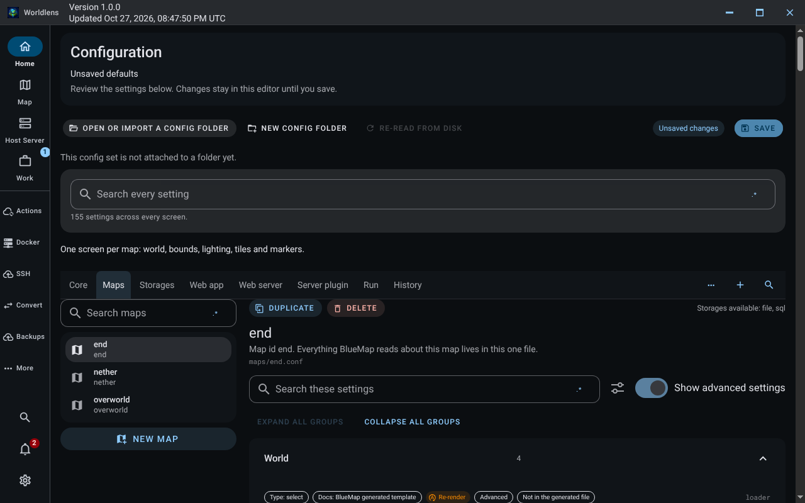
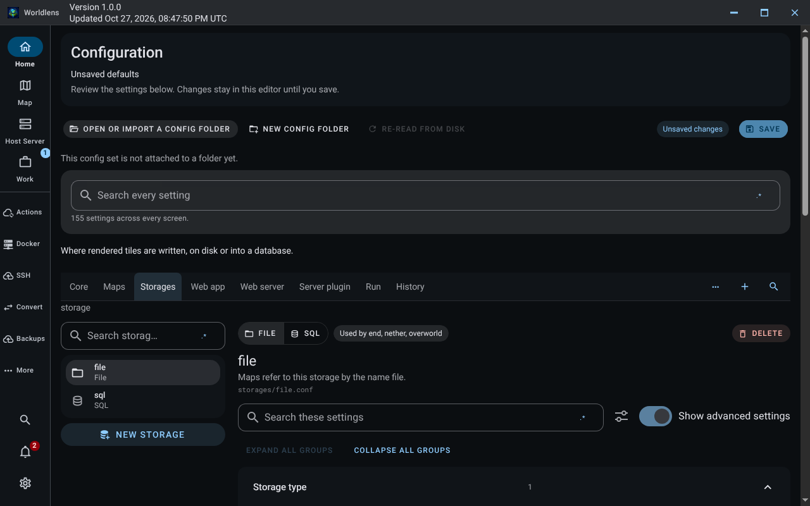
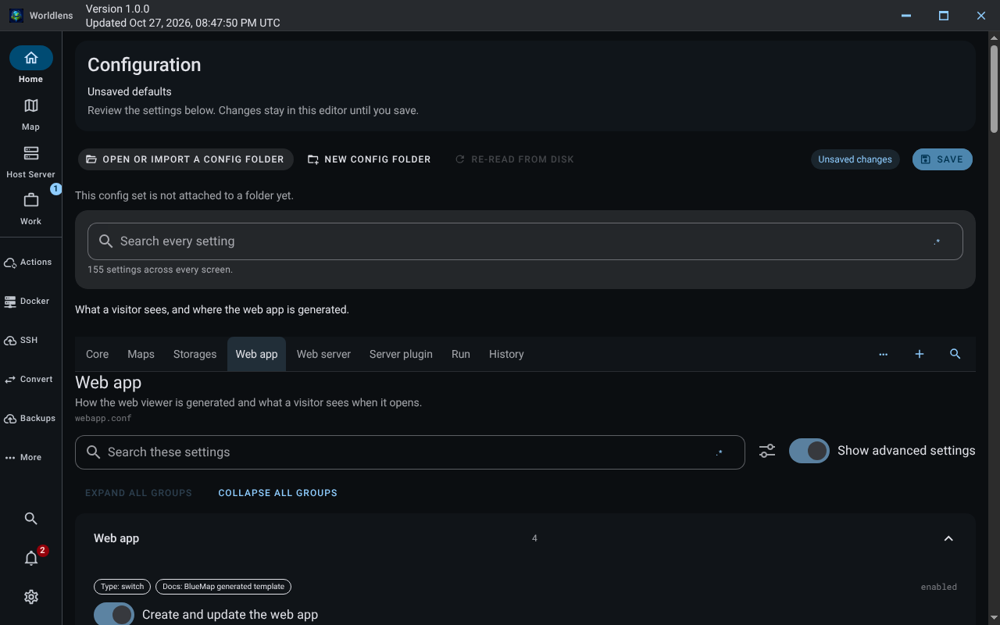
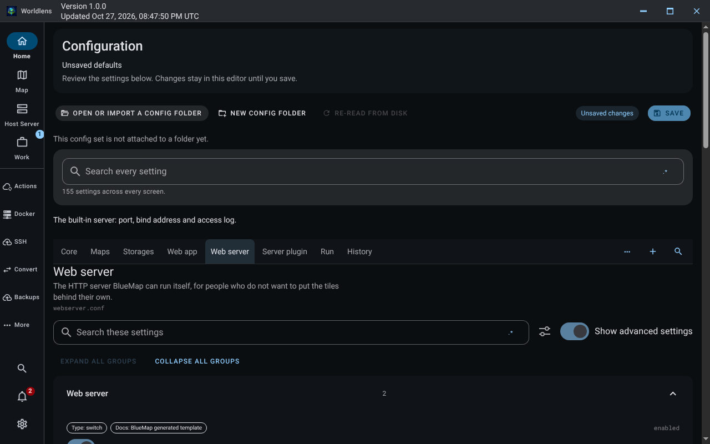
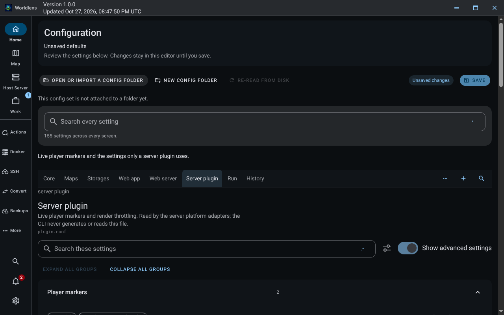
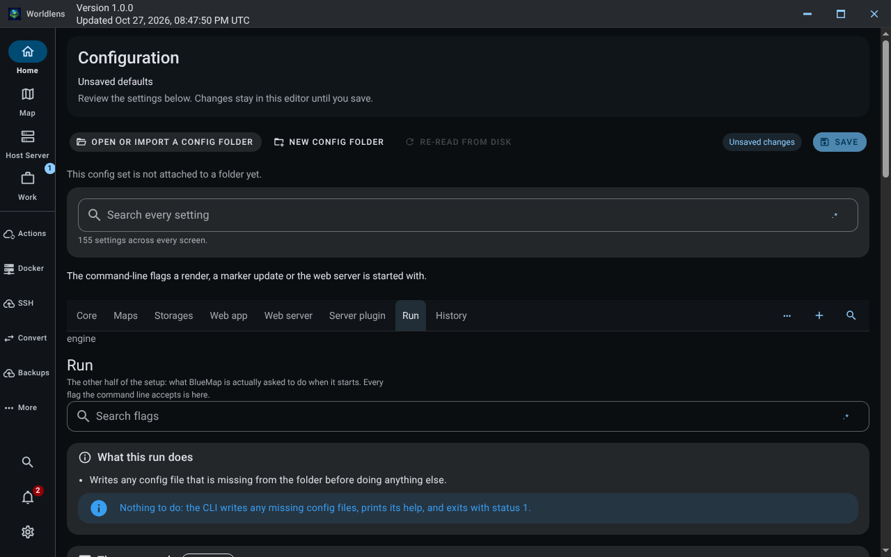
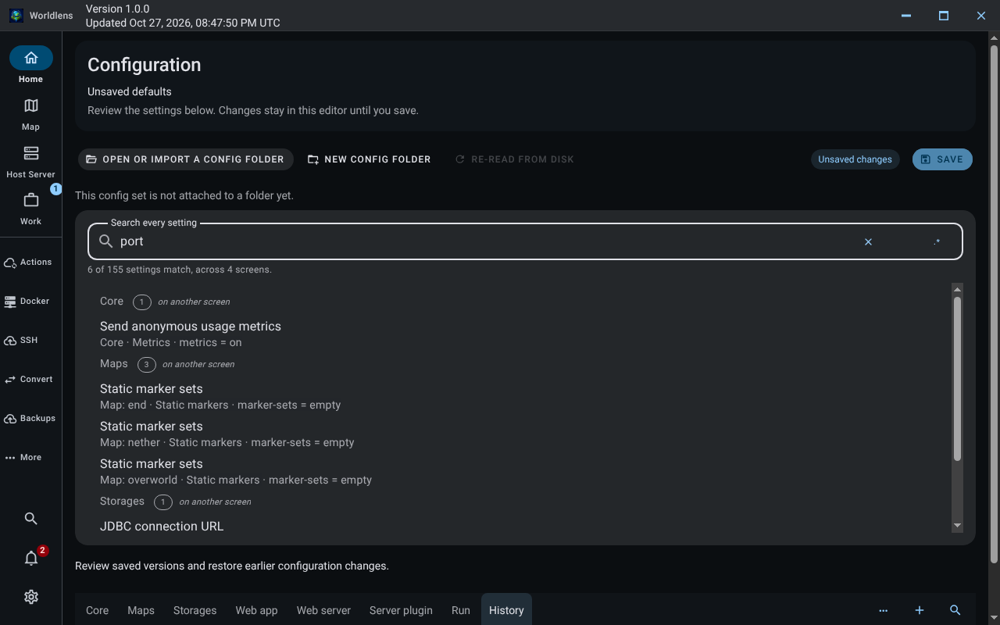
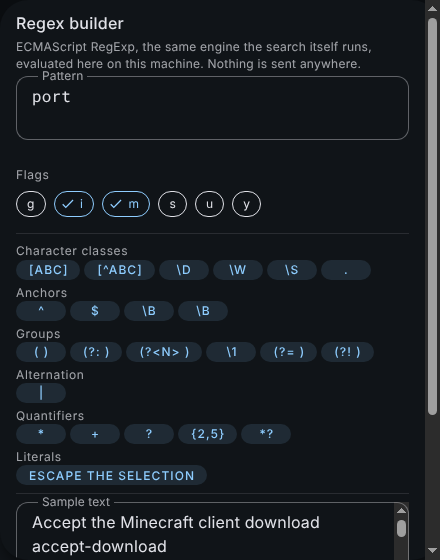
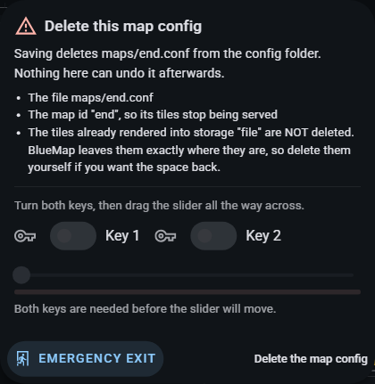

# Historical configuration catalogue records

These catalogue descriptions preceded the source-49d009b5 refresh. The original PNG files and existing recorded dates remain unchanged. Historical descriptions below are retained verbatim; statements about being current refer to their original observation, not the current build. Missing original timing or source metadata remains unavailable.

## config-screen.png



```typescript
    {
        file: "config-screen.png",
        aspectRatio: "8 / 5",
        title: "The options editor",
        configuration: "1280 by 800, with no configuration folder attached",
        alt: "Historical capture of the options editor filling the window: a toolbar for opening, importing, generating, re-reading and saving a config folder, with an unsaved-changes marker and a Save button; a search field reading 154 settings across every screen before the client-decompression setting was added; and a column of eight tabs (Core, Maps, Storages, Web app, Web server, Server plugin, Run and History) beside the Core tab's own settings, which open on the render-speed dial. A message in the corner says that BlueMap's own defaults are being shown because nothing has been opened from disk yet.",
        featured: true,
    },
```

## config-tab-core.png


```typescript
    {
        file: "config-tab-core.png",
        aspectRatio: "8 / 5",
        title: "Options: the Core tab",
        configuration: "1280 by 800, with no configuration folder attached",
        alt: "The Core tab of the options editor, holding the settings that apply to every map: the Minecraft client download, folders, render threads and logging.",
        featured: false,
    },
```

## config-tab-maps.png



```typescript
    {
        file: "config-tab-maps.png",
        aspectRatio: "8 / 5",
        title: "Options: the Maps tab",
        configuration: "1280 by 800, with no configuration folder attached",
        alt: "The Maps tab of the options editor, with a list of map configurations down the side and the selected map's world, bounds, lighting, tiles and markers beside it.",
        featured: false,
    },
```

## config-tab-storages.png



```typescript
    {
        file: "config-tab-storages.png",
        aspectRatio: "8 / 5",
        title: "Options: the Storages tab",
        configuration: "1280 by 800, with no configuration folder attached",
        alt: "The Storages tab of the options editor, which sets where rendered tiles are written, on disk or into a database.",
        featured: false,
    },
```

## config-tab-web-app.png



```typescript
    {
        file: "config-tab-web-app.png",
        aspectRatio: "8 / 5",
        title: "Options: the Web app tab",
        configuration: "1280 by 800, with no configuration folder attached",
        alt: "The Web app tab of the options editor, holding what a visitor sees and where the web app is generated.",
        featured: false,
    },
```

## config-tab-web-server.png



```typescript
    {
        file: "config-tab-web-server.png",
        aspectRatio: "8 / 5",
        title: "Options: the Web server tab",
        configuration: "1280 by 800, with no configuration folder attached",
        alt: "The Web server tab of the options editor, holding the built-in server's port, bind address and access log.",
        featured: false,
    },
```

## config-tab-server-plugin.png



```typescript
    {
        file: "config-tab-server-plugin.png",
        aspectRatio: "8 / 5",
        title: "Options: the Server plugin tab",
        configuration: "1280 by 800, with no configuration folder attached",
        alt: "The Server plugin tab of the options editor, holding live player markers and the settings only a server plugin uses.",
        featured: false,
    },
```

## config-tab-run.png



```typescript
    {
        file: "config-tab-run.png",
        aspectRatio: "8 / 5",
        title: "Options: the Run tab",
        configuration: "1280 by 800, with no configuration folder attached",
        alt: "The Run tab of the options editor, showing the command line flags a render, a marker update or the web server would be started with.",
        featured: false,
    },
```

## config-search.png



```typescript
    {
        file: "config-search.png",
        aspectRatio: "8 / 5",
        title: "The options search, across every tab",
        configuration: "1280 by 800, with a query typed in",
        alt: "The options editor's search with a query typed in, listing the matching settings from every one of its eight tabs at once and naming which tab each result lives on, so a match on a tab that is not open is still reachable.",
        featured: false,
    },
```

## config-regex-builder.png



```typescript
    {
        file: "config-regex-builder.png",
        aspectRatio: "11 / 14",
        title: "The regex builder, from the options editor",
        configuration: "cropped to the builder anchored to the options search bar",
        alt: "The regex builder anchored to the options editor's search bar, with the pattern, the supported flags, the guided token palette and the live matches beneath.",
        featured: false,
    },
```

## config-delete-gate.png



```typescript
    {
        file: "config-delete-gate.png",
        aspectRatio: "60 / 61",
        title: "Deleting a map's configuration",
        configuration: "cropped to the confirmation anchored beside the delete button",
        alt: "The confirmation that guards deleting a map's configuration. It names the file that would go, the map id whose tiles stop being served, and says plainly that already-rendered tiles are not deleted. Two key switches sit above a slider that will not move until both are turned, and an emergency exit is offered beside the confirm button.",
        featured: false,
    },
```
