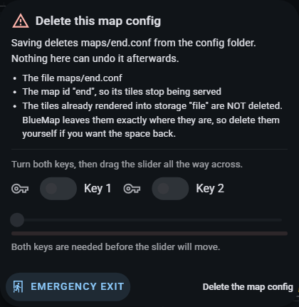

# Earlier configuration editor captures

Preserved from README at source ae1df096. The original PNG bytes and captions are unchanged. Original capture dates are not established by this archive; consult the existing capture manifest where available. These images are historical, not the current editor.

<b>The options editor</b> - all eight tabs of BlueMap's own configuration

Captured 2026-08-15 against the current build, so this is not a historical image: the generated
options inventory it shows carries all **155 settings**, including `client-decompression`.

|                                                                                                                                                                        |                                                                                                                                                      |                                                                                                                                       |
| ---------------------------------------------------------------------------------------------------------------------------------------------------------------------- | ---------------------------------------------------------------------------------------------------------------------------------------------------- | ------------------------------------------------------------------------------------------------------------------------------------- |
|                                                                   |                                                 |                          |
| Core                                                                                                                                                                   | Maps                                                                                                                                                 | Storages                                                                                                                              |
|                                                             |                                     |                |
| Web app                                                                                                                                                                | Web server                                                                                                                                           | Server plugin                                                                                                                         |
|            |  |  |
| Run                                                                                                                                                                    | The search across every tab                                                                                                                          | Its regex builder                                                                                                                     |
|  |                                                                                                                                                      |                                                                                                                                       |
| History                                                                                                                                                                |                                                                                                                                                      |                                                                                                                                       |

Deleting a map's configuration is guarded the same way any destructive action is, and the gate
names what would actually go before it asks.

These captures show the editor holding BlueMap's own generated defaults, which is what it opens
on when this machine has no config folder to carry on from - it says so in a notice across the
top. Every setting, tab and control in them is real, live and savable; what is absent is a folder
read off the machine, not the ability to write one.

