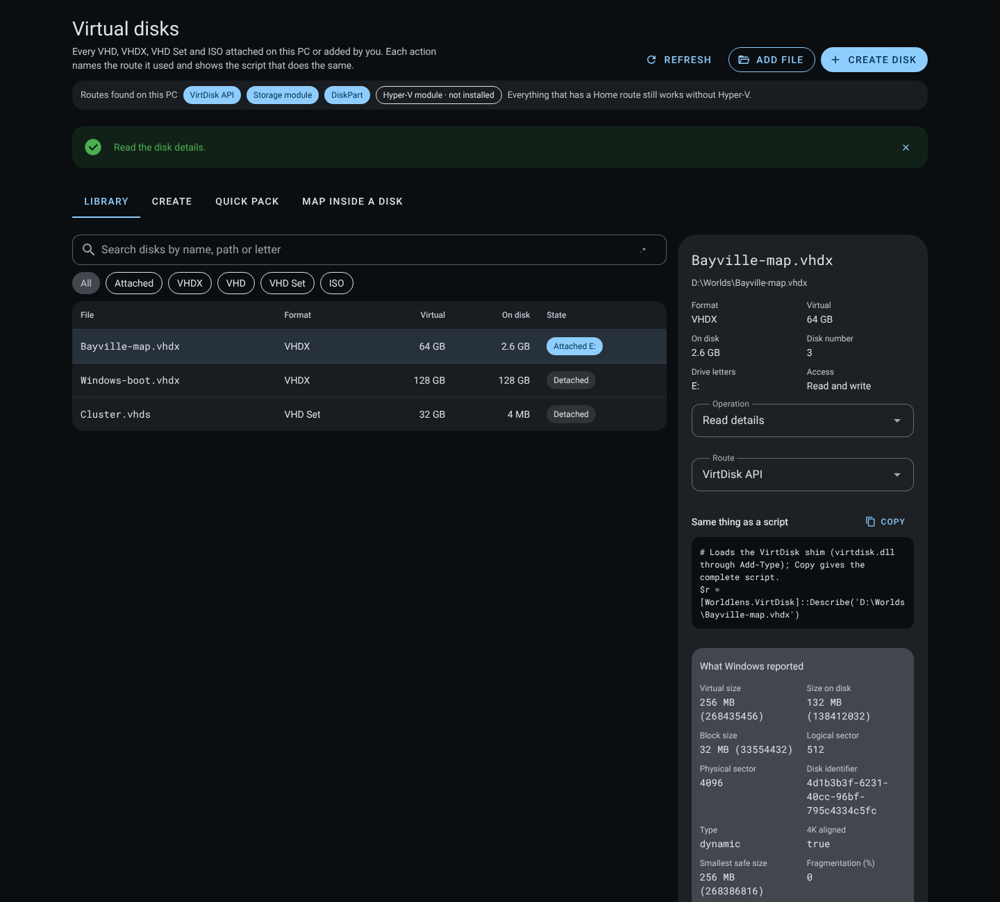
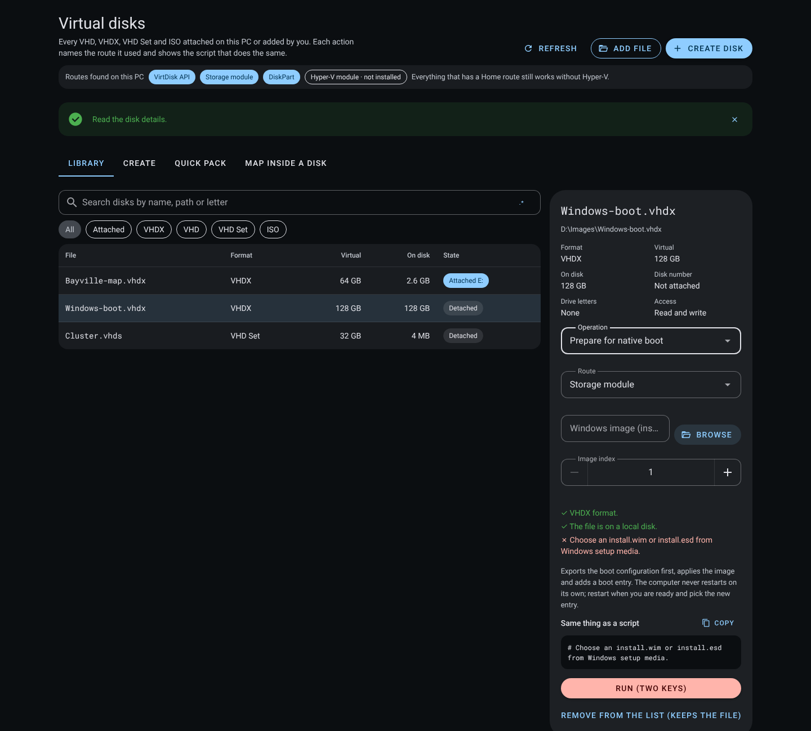
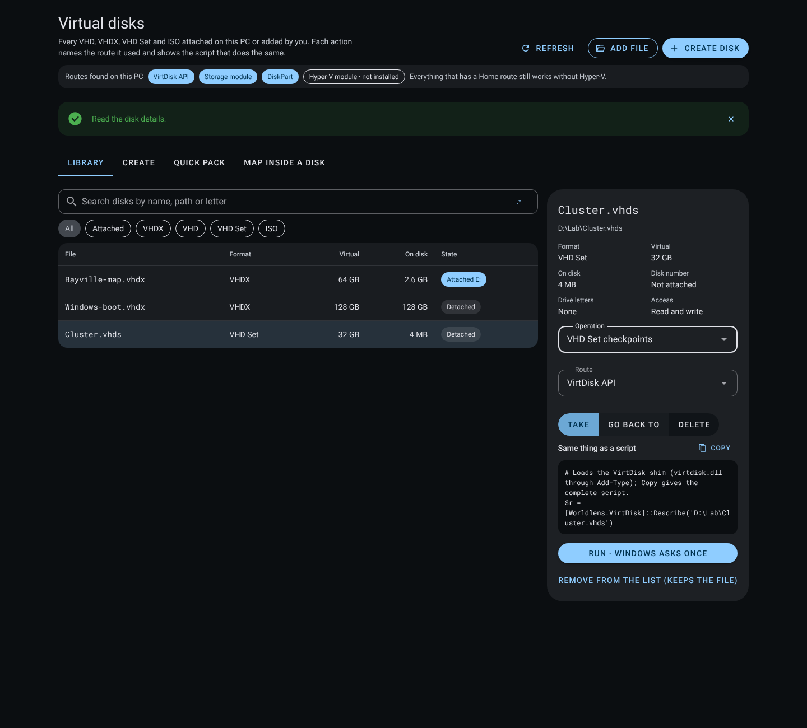

# Virtual disks

The **Virtual disks** job manages VHD, VHDX, VHD Set and ISO files on Windows. Open it from the command palette (`Ctrl+Shift+F`, then type "Virtual disks") or from the Work tabs. Dropping a `.vhd`, `.vhdx`, `.vhds`, `.avhd`, `.avhdx` or `.iso` file on the screen adds it to the library.

## Routes

On start the manager checks which tools this PC has: the VirtDisk API (`virtdisk.dll`), the Storage module (`Mount-DiskImage`), DiskPart and the Hyper-V module (`Resize-VHD`). It never installs or enables Hyper-V. Every result names the route that did the work, and every operation shows the script for that route with a Copy button, so the same step can be run by hand. A VirtDisk step loads a small C# shim through `Add-Type`; the preview shows the one call that matters and Copy gives the whole script.

| Operation | Routes, best first | Without Hyper-V |
| --- | --- | --- |
| Read details: size, size on disk, block and sector sizes, identifier, type, 4K alignment, smallest safe size, fragmentation, parents, change tracking | VirtDisk API | Yes |
| Create (fixed, dynamic, differencing, VHD Set) with optional GPT, one formatted volume and a letter or folder mount | DiskPart, VirtDisk API | Yes |
| Attach (read-write or read-only) and detach | Storage module, DiskPart | Yes |
| Grow, and extend a volume into the new space | VirtDisk API, DiskPart, Hyper-V | Yes |
| Shrink to a size or to the smallest safe size | VirtDisk API, Hyper-V | Yes |
| Compact (Full and Quick through VirtDisk or DiskPart; Retrim, Pretrimmed and Prezeroed through Hyper-V) | VirtDisk API, DiskPart, Hyper-V | Full and Quick |
| Convert to VHD or VHDX, fixed or dynamic, as a new file | VirtDisk API, Hyper-V | Yes |
| Merge a differencing disk into its parent; change a child's parent | VirtDisk API, DiskPart, Hyper-V | Yes |
| New disk identifier; physical sector size | VirtDisk API, Hyper-V | Yes |
| Custom metadata: list, set, delete | VirtDisk API | Yes |
| Change tracking: on, off, changed ranges since an id | VirtDisk API | Yes |
| VHD Set checkpoints: take, go back to, delete | VirtDisk API | Yes |
| Mirror to a new file while the disk stays usable | VirtDisk API | Yes |
| Make an empty VHDX a Dev Drive (ReFS) | Storage module | Yes, on Windows 11 22621.2338 or later |
| Prepare a fixed VHDX for native boot | Storage module with DISM and bcdboot | Yes |

Changing a disk needs administrator rights, so each run asks once through the standard Windows permission prompt. A declined prompt is reported as cancelled with nothing changed, never as done. A VirtDisk or PowerShell step reports its own JSON verdict, and that verdict decides success, not the exit code alone. What Windows reported is shown under the operation with plain names.

Shrink, merge, change parent, new identifier, deleting metadata, going back to or deleting a checkpoint, Dev Drive and native boot need the two-key confirmation first.

### Native boot

Native boot applies a Windows image (`install.wim` or `install.esd`) to an empty fixed VHDX and adds a boot entry. The boot configuration is exported to the app's data folder first, DISM applies the image, `bcdboot` adds the entry and the disk is detached. The computer never restarts on its own: restart when you are ready and pick the new entry. The screen checks the format, a local path and the chosen image before it offers the step; the script refuses a disk that already has partitions.

### VHD Set checkpoints

A VHD Set (`.vhds`) is a header file plus a backing disk. Take a checkpoint, go back to one by its identifier, or delete one. Going back tries the documented field and flag combinations in turn and reports which one Windows accepted.

## Create

Format limits are checked before anything is written: at least 3 MB, at most 2,040 GB for VHD and 64 TB for VHDX. VHDX block sizes are powers of two from 1 MB to 256 MB; sector sizes are 512 or 4096 bytes, and VHD allows only 512-byte logical sectors. A differencing disk needs a parent. Network locations are refused. An existing file is never overwritten. Presets fill in a portable data disk, a Dev Drive, a native boot disk and a differencing scratch copy.

## Quick pack

Drop files or folders on the Quick pack target, or choose a folder. Worldlens:

1. Sizes a dynamic VHDX from the files (cluster rounding, file records, partition layout, metadata and headroom).
2. Creates it beside the first dropped item, named after it. A name that exists gets a number, `Photos (1).vhdx`; nothing is overwritten.
3. Formats one NTFS volume and mounts it to a private folder, with no drive letter used.
4. Copies every file with its folder tree and timestamps, hashing the source while copying and the copy afterwards with SHA-256. A mismatch or an unreadable file is listed and the pack is reported as partial.
5. Grows the VHDX and extends its volume automatically when the copy runs out of space, then carries on from the same file. Each growth is reported.
6. Detaches the disk and adds it to the library.

Cancel detaches and removes only the VHDX this run created. Sources are only ever read.

Not yet copied: alternate data streams and permissions.

## Map inside a disk

A rendered map is often a million small tile files. The **Map inside a disk** tab keeps it in one VHDX instead: Worldlens estimates a starting size from the number of region files, creates the disk with 4 KB clusters (or attaches it if it exists), mounts it to a private folder and points map storage at that folder. Renders then write into the disk. `growMapDiskIfNeeded` grows the disk when free space falls under 10 percent.

## Other systems and hosted mode

On macOS and Linux the screen says plainly that virtual disks need Windows; the create form and scripts stay readable. A hosted (container) deployment refuses the `vdisk:` channels, because a disk attached on the server would be on the wrong machine.

## Verification

- `design/packages/shared/src/virtualDisk.test.ts`: format limits, never-overwrite naming, Quick pack sizing, growth limits, routes without Hyper-V, exact scripts, conversion, Dev Drive and native boot checks.
- `design/packages/app/src/main/vdisk/manager.test.ts`: with a fake Windows runner that never touches a real disk, the Home-route grow, a declined prompt reported as cancelled, refusal to create over a file, VirtDisk shrink to the smallest safe size, the API's verdict taking precedence over the exit code, every remaining operation on a Home route, compact modes the API cannot do refused with the route that can, Hyper-V when chosen, script previews, the library, Quick pack (removing the out-of-space branch turns the growth test red), cancel cleanup and render-into-VHDX mounting.
- `design/packages/app/src/main/vdisk/manager.windows.test.ts`, run by the **Virtual disks on Windows** workflow on a hosted Windows Server 2025 runner (build 26100) against real VHD, VHDX and VHD Set files: all 14 steps pass in run 42507510508 (8 November 2026). Routes found; create with a folder mount, write and detach; read details; grow and shrink to the smallest safe size; new identifier; metadata; change tracking with a changed-range query; Quick and Full compact; convert to a fixed VHD; differencing, change parent and merge; VHD Set with take, go back and delete; mirror; Quick pack; Dev Drive. That runner has the Hyper-V module installed, but none of these steps used it: every VirtDisk step ran through `virtdisk.dll` and the run log names the route of each. Native boot is not run there because it changes the runner's boot configuration; its script and checks are covered by unit tests.
- `design/packages/ui/src/components/vdisk/VirtualDisksScreen.test.ts`: library, route chips, script preview, cancelled prompt, Windows-required state, format filter, every VirtDisk operation offered, two keys for the ones that change a disk, and what Windows reported.
- Screenshots in `docs/evidence/virtual-disks/`: the library, create and map screenshots come from the built interface in headless Chrome without the desktop bridge. The three operation screenshots come from the screen mounted on its own with a stand-in bridge that answers with the values the Windows run reported; they show the screen, not a live disk.

## 廣東話

**虛擬磁碟** 工作喺 Windows 度管理 VHD、VHDX、VHD Set 同 ISO 檔。喺指令面板(`Ctrl+Shift+F`)或者「工作」分頁開。將 `.vhd`、`.vhdx`、`.vhds`、`.avhd`、`.avhdx` 或者 `.iso` 拖入畫面就會加入清單。

- **路線:** 一開就檢查呢部電腦有乜工具:VirtDisk API(`virtdisk.dll`)、Storage 模組(`Mount-DiskImage`)、DiskPart 同 Hyper-V 模組。永遠唔會幫你裝或者開 Hyper-V。每個結果都講明用咗邊條路線,每個操作都顯示同一樣嘢嘅腳本,有複製掣。VirtDisk 步驟經 `Add-Type` 載入一段細細嘅 C#;預覽淨係顯示最重要嗰句,複製就攞成份腳本。
- **冇 Hyper-V 都做到:** 讀資料、建立(包括差異磁碟同 VHD Set)、掛上同卸落、加大、縮細(可以縮到最細又安全嘅大細)、壓實(Full 同 Quick)、轉換做新檔、合併同換上層磁碟、換識別碼同實體磁區大細、中繼資料、變更追蹤、VHD Set 檢查點、鏡像去新檔、整 Dev Drive(Windows 11 22621.2338 或以上)、準備原生開機。Retrim、Pretrimmed 同 Prezeroed 壓實先要 Hyper-V。
- **權限:** 改磁碟要管理員權限,所以每次都經標準 Windows 權限提示問一次。撳咗拒絕就報「取消咗,乜都冇改」,永遠唔會當做完。VirtDisk 同 PowerShell 步驟會報自己嘅 JSON 結果,以嗰個結果為準,唔係淨睇結束碼。Windows 報告咗乜,會用平常字眼顯示喺操作下面。
- **兩條鎖匙:** 縮細、合併、換上層、換識別碼、刪中繼資料、返去或者刪檢查點、Dev Drive 同原生開機,都要先過兩條鎖匙確認。
- **原生開機:** 將 Windows 映像套用落一個空嘅固定 VHDX,再加開機項目。會先將開機設定匯出到程式資料夾,DISM 套用映像,`bcdboot` 加項目,然後卸落磁碟。部電腦唔會自己重開;你準備好先重開,再揀新項目。
- **VHD Set 檢查點:** VHD Set(`.vhds`)係一個標頭檔加一隻後備磁碟。可以影低檢查點、用識別碼返去、或者刪除。返去嗰陣會逐個試文件寫明嘅組合,再報返 Windows 接受咗邊個。
- **建立:** 寫任何嘢之前先檢查格式限制:最少 3 MB,VHD 最多 2,040 GB,VHDX 最多 64 TB。舊檔永遠唔會被蓋過。
- **Quick pack:** 將檔案或者資料夾拖去 Quick pack,會喺旁邊整一個 VHDX,逐個檔案抄入去再用 SHA-256 核對,唔夠位就自動加大再繼續,做完卸落。取消淨係會刪今次整嘅 VHDX,原檔只會被讀。
- **地圖放入磁碟:** 將渲染出嚟嘅地圖放入一個 VHDX,唔使散開成百萬個細檔。空間少過 10% 會自動加大。
- **驗證:** 喺 GitHub 嘅 Windows Server 2025 runner(build 26100)用真嘅 VHD、VHDX 同 VHD Set 檔測試,14 步全部通過(2026 年 11 月 8 日,run 42507510508)。嗰部 runner 有裝 Hyper-V 模組,但係呢啲步驟一步都冇用過佢。原生開機會改 runner 嘅開機設定,所以冇喺嗰度跑,腳本同檢查由單元測試覆蓋。三張操作截圖係用替身橋接,答返 Windows 測試報告嘅數值,顯示嘅係畫面,唔係真磁碟。
