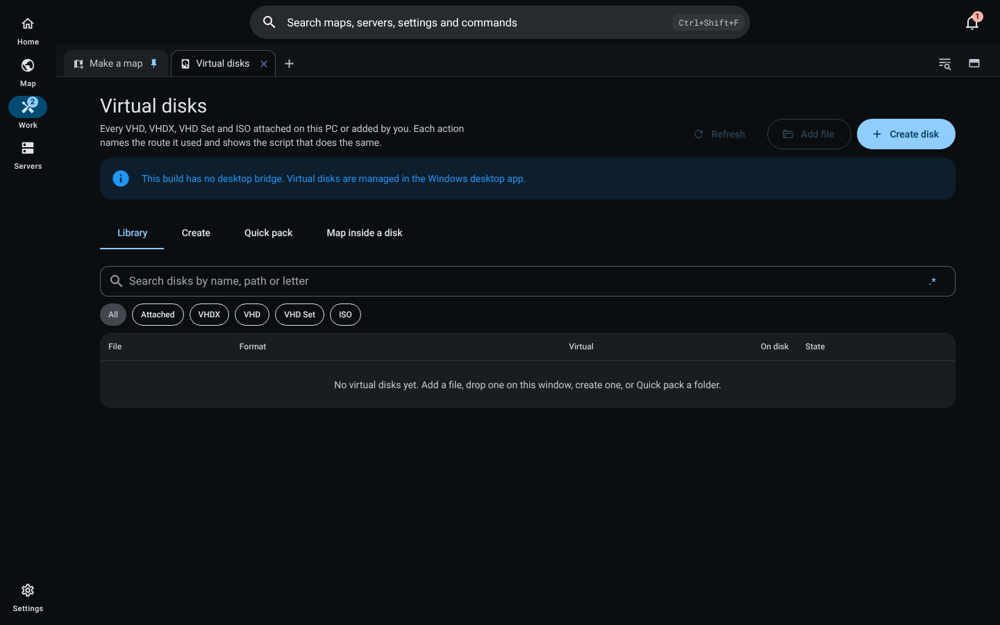
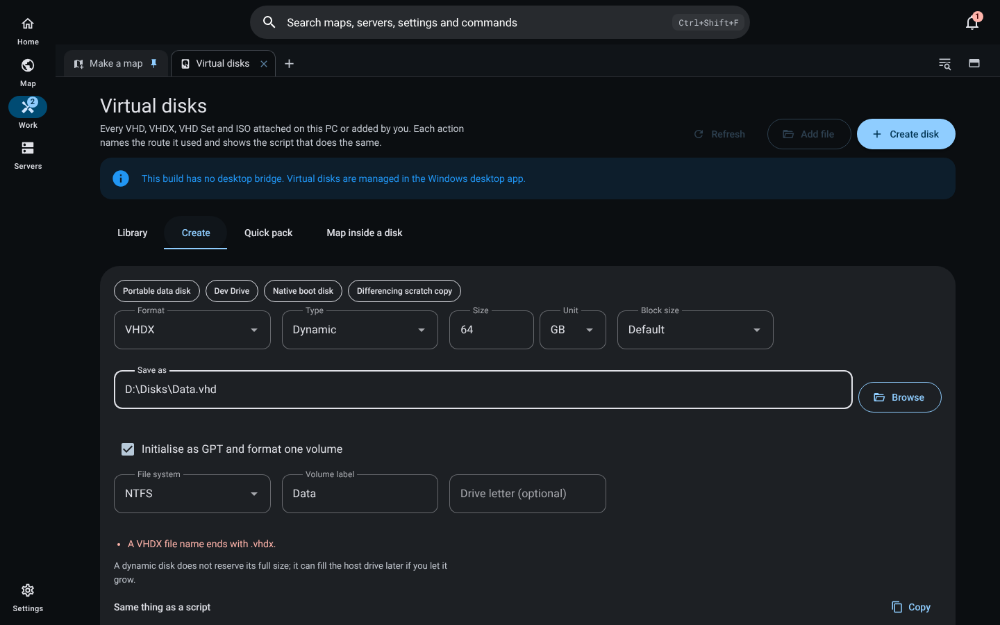
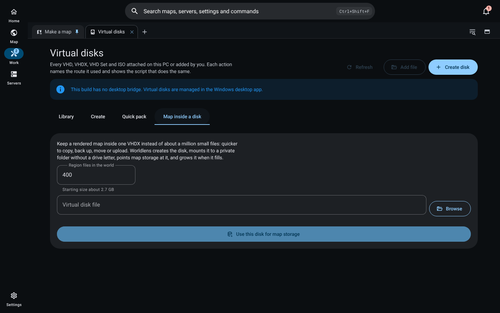

# Virtual disks

The **Virtual disks** job manages VHD, VHDX, VHD Set and ISO files on Windows. Open it from the command palette (`Ctrl+Shift+F`, then type "Virtual disks") or from the Work tabs. Dropping a `.vhd`, `.vhdx`, `.vhds`, `.avhd`, `.avhdx` or `.iso` file on the screen adds it to the library.

## Routes

On start the manager checks which tools this PC has: the VirtDisk API (`virtdisk.dll`), the Storage module (`Mount-DiskImage`), DiskPart and the Hyper-V module (`Resize-VHD`). It never installs or enables Hyper-V. Every result names the route that did the work, and every operation shows the exact script for that route with a Copy button, so the same step can be run by hand.

| Operation | Routes, best first | Without Hyper-V |
| --- | --- | --- |
| Create (fixed, dynamic, differencing) with optional GPT, one formatted volume and a letter or folder mount | DiskPart | Yes |
| Attach (read-write or read-only) and detach | Storage module, DiskPart | Yes |
| Grow, and extend a volume into the new space | DiskPart, Hyper-V | Yes |
| Compact (Full through DiskPart; every mode through Hyper-V) | DiskPart, Hyper-V | Full mode |
| Merge a differencing disk into its parent | DiskPart, Hyper-V | Yes |
| Shrink, convert, reset the disk identifier | Hyper-V | Not yet: the VirtDisk API route for these is designed but not wired in this build, and the screen says so |

Changing a disk needs administrator rights, so each run asks once through the standard Windows permission prompt. A declined prompt is reported as cancelled with nothing changed, never as done. Shrink, merge and identifier reset need the two-key confirmation first.

## Create

Format limits are checked before anything is written: at least 3 MB, at most 2,040 GB for VHD and 64 TB for VHDX. VHDX block sizes are powers of two from 1 MB to 256 MB; sector sizes are 512 or 4096 bytes, and VHD allows only 512-byte logical sectors. A differencing disk needs a parent. Network locations are refused. An existing file is never overwritten. Presets fill in a portable data disk, a Dev Drive, a native boot disk and a differencing scratch copy.

## Quick pack

Drop files or folders on the Quick pack target, or choose a folder. Worldlens:

1. Sizes a dynamic VHDX from the files (cluster rounding, file records, partition layout, metadata and headroom).
2. Creates it beside the first dropped item, named after it. A name that exists gets a number, `Photos (1).vhdx`; nothing is overwritten.
3. Formats one NTFS volume and mounts it to a private folder, with no drive letter used.
4. Copies every file with its folder tree and timestamps, hashing the source while copying and the copy afterwards with SHA-256. A mismatch or an unreadable file is listed and the pack is reported as partial.
5. Grows the VHDX and extends its volume automatically when the copy runs out of space, then carries on from the same file. Each growth is reported.
6. Detaches the disk and adds it to the library.

Cancel detaches and removes only the VHDX this run created. Sources are only ever read.

Not yet copied: alternate data streams and permissions.

## Map inside a disk

A rendered map is often a million small tile files. The **Map inside a disk** tab keeps it in one VHDX instead: Worldlens estimates a starting size from the number of region files, creates the disk with 4 KB clusters (or attaches it if it exists), mounts it to a private folder and points map storage at that folder. Renders then write into the disk. `growMapDiskIfNeeded` grows the disk when free space falls under 10 percent.

## Other systems and hosted mode

On macOS and Linux the screen says plainly that virtual disks need Windows; the create form and scripts stay readable. A hosted (container) deployment refuses the `vdisk:` channels, because a disk attached on the server would be on the wrong machine.

## Verification

- `design/packages/shared/src/virtualDisk.test.ts`: format limits, never-overwrite naming, Quick pack sizing, growth limits, routes without Hyper-V, exact scripts, conversion and Dev Drive checks.
- `design/packages/app/src/main/vdisk/manager.test.ts`: with a fake Windows runner that never touches a real disk, the Home-route grow, a declined prompt reported as cancelled, refusal to create over a file, shrink refused without Hyper-V and run with it, the library, Quick pack round trip with a numbered name, automatic growth (removing the out-of-space branch turns this test red), cancel cleanup and render-into-VHDX mounting.
- `design/packages/ui/src/components/vdisk/VirtualDisksScreen.test.ts`: library, route chips, script preview, cancelled prompt, Windows-required state and format filter.
- Screenshots in `docs/evidence/virtual-disks/` come from the built interface (`design/packages/ui/dist`) in headless Chrome on Linux, without the desktop bridge. Operations on a real Windows host remain to be verified.
